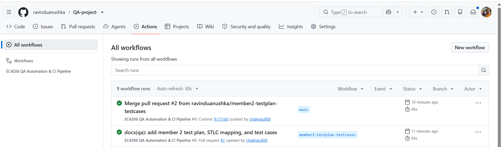

## Section 3.1: Introduction & Test Planning (LO-1)

### 1. Scope
- **In-Scope Modules (`cylixlab`):** Authentication & Student Dashboard (`Personal Details`, `To-Do Lists`, `Learning & Assignment`, `Online Chatbox`, `Motivational Quotes`, `Analyze Progress`), Courses, PDF Materials, and Assignments.
- **Out-of-Scope Features:** Changes to the original `cylixlab` codebase or live production deployment, external payment/billing integrations (if any), and specialized load/security/coverage/defect-lifecycle tasks owned by other team members.

### 2. Test Plan
- **Objectives:** Verify functional behavior across core `cylixlab` features, identify issues early using an isolated test environment (`cylixlab_test`), and assess system quality against ISO 25010 characteristics.
- **Scope:** Covers in-scope student/learning workflows within the isolated `QA-project-` repository while keeping production untouched.
- **Team Resources:**
  - **Member 1:** `.env` and GitHub Secrets setup, UI/API test automation, GitHub Actions CI/CD, and SonarQube scanning/refactoring.
  - **Member 2 (Me):** Introduction, Test Plan, ISO 25010 characteristics, Verification vs. Validation, STLC mapping, 12 formal test cases, and test environment configuration.
  - **Member 3:** Black-box testing (Equivalence Partitioning, Boundary Value Analysis, Decision Table) and defect tracking/RCA/bug lifecycle in GitHub Issues.
  - **Member 4:** White-box testing (CFG, Cyclomatic Complexity, statement/branch coverage), TDD/BDD (unit tests & Gherkin/Cucumber), JMeter/OWASP checks, and Agile/DevOps reflection.
- **Testing Schedule:**
  - **Stage 1 – Setup & Test Plan:** Clone `QA-project-`, configure `server/.env` (`cylixlab_test`), run backend (`localhost:5000`) and frontend (`localhost:5173`), and document scope & test plan.
  - **Stage 2 – STLC & Test Cases:** Map STLC phases and design 10–15 formal test cases with all 7 required fields.
  - **Stage 3 – Execution & Submission:** Execute test cases on local build, record actual results and pass/fail statuses, commit to `member2-testplan-testcases`, and open a Pull Request to `main`.

### 3. Targeted ISO 25010 Quality Characteristics
- **Functional Suitability:** Verifies login, dashboard modules, courses, PDF materials, and assignments perform their required functions accurately.
- **Reliability:** Verifies stable backend (`PORT=5000`) and MongoDB (`cylixlab_test`) operation without crashes during test execution.
- **Usability:** Verifies dashboard navigation, controls (`Back to Home`, module buttons), and user workflows are clear and easy to use.
- **Security:** Verifies authentication, session/token handling, and route access behavior.

### 4. Verification vs. Validation Activities
- **Verification:** Checking alignment with EC4206 assignment requirements, inspecting `.env` (`cylixlab_test`) and `.gitignore` isolation, and reviewing configuration/code structure.
- **Validation:** Running real UI and API flows on `http://localhost:5173/student-dashboard` and `http://localhost:5000` to confirm actual application behavior matches user expectations.

---

## Section 3.2: STLC & Test Cases (LO-1, LO-2)

### 1. STLC Mapping to `cylixlab`
1. **Requirement Analysis:** Reviewing `cylixlab` features (Auth, Student Dashboard modules, Courses, PDF Materials, Assignments) and EC4206 task requirements to identify testable scenarios.
2. **Test Planning:** Defining in-scope/out-of-scope items, ISO 25010 targets, team workload, schedule, and isolated `cylixlab_test` configuration.
3. **Test Case Design:** Authoring 12 formal test cases containing ID, Description, Preconditions, Steps, Expected Result, Actual Result, and Status.
4. **Execution:** Running the local backend and frontend, executing test cases against `cylixlab_test`, and recording Actual Results and Statuses.
5. **Closure:** Summarizing test execution outcomes, confirming test environment configuration, and submitting via Pull Request from `member2-testplan-testcases` to `main`.

### 2. Test Environment / Configuration
- **OS:** Windows 11
- **Browser:** Google Chrome Version `157.0.8103.79` (Official Build) (64-bit)
- **Node.js / React Versions:** Node.js `v24.15.0`, React `^19.2.8` (Vite `^8.3.0`)
- **`cylixlab_test` Setup:** Local Express/Node server on `http://localhost:5000` (`PORT=5000`), Vite frontend on `http://localhost:5173`, `JWT_SECRET` in git-ignored `server/.env`, and MongoDB database `cylixlab_test` (`mongodb://127.0.0.1:27017/cylixlab_test`).

### 3. Formal Test Cases

| ID | Description | Preconditions | Steps | Expected Result | Actual Result | Status |
| :--- | :--- | :--- | :--- | :--- | :--- | :--- |
| TC-01 | Student login & dashboard load | App running; valid student account exists in `cylixlab_test` | 1. Open login page. 2. Enter valid credentials and submit. | Student logs in and `http://localhost:5173/student-dashboard` loads (`welcome back , Chalindu !`). | Student dashboard loaded with `welcome back , Chalindu !`. | Pass |
| TC-02 | Invalid login credentials rejected | App running on `http://localhost:5173` | 1. Open login page. 2. Enter valid email and invalid password. 3. Submit login. | Login is rejected with an error message; user does not enter dashboard. | [Fill after running] | [Pass/Fail] |
| TC-03 | Navigate back to Home from Student Dashboard | User is on `/student-dashboard` | 1. Click `<- Back to Home`. | Navigates cleanly back to the Home page. | [Fill after running] | [Pass/Fail] |
| TC-04 | View and update Personal Details | User logged in on Student Dashboard | 1. Click `Personal Details`. 2. View/update allowed details and save. | Personal details display and save to `cylixlab_test` without error. | [Fill after running] | [Pass/Fail] |
| TC-05 | Add item to To-Do Lists | User logged in on Student Dashboard | 1. Click `To-Do Lists`. 2. Add a to-do item and save. | Item appears in the to-do list and persists across reload. | [Fill after running] | [Pass/Fail] |
| TC-06 | Open Learning & Assignment module | User logged in on Student Dashboard | 1. Click `Learning & Assignment`. | Courses/learning content and assignments view loads properly. | [Fill after running] | [Pass/Fail] |
| TC-07 | View PDF learning material | Course contains a PDF learning material | 1. Open course/learning module. 2. Open PDF material. | PDF material renders/opens properly without broken link or error. | [Fill after running] | [Pass/Fail] |
| TC-08 | Submit an assignment | Assignment available in `Learning & Assignment` | 1. Open assignment. 2. Enter valid submission and submit. | Assignment submission succeeds and confirmation is displayed. | [Fill after running] | [Pass/Fail] |
| TC-09 | Send message in Online Chatbox | User logged in on Student Dashboard | 1. Click `Online Chatbox`. 2. Type a message and send. | Message is sent and appears in the chatbox. | [Fill after running] | [Pass/Fail] |
| TC-10 | View Motivational Quotes | User logged in on Student Dashboard | 1. Click `Motivational Quotes`. | Motivational quote(s) render cleanly on the page. | [Fill after running] | [Pass/Fail] |
| TC-11 | View Analyze Progress | User logged in on Student Dashboard | 1. Click `Analyze Progress`. | Student progress analytics/metrics display without runtime errors. | [Fill after running] | [Pass/Fail] |
| TC-12 | Logout clears session | User currently logged in | 1. Click Logout. 2. Try navigating directly to `/student-dashboard`. | Session is cleared and access to `/student-dashboard` is restricted/redirected. | [Fill after running] | [Pass/Fail] |