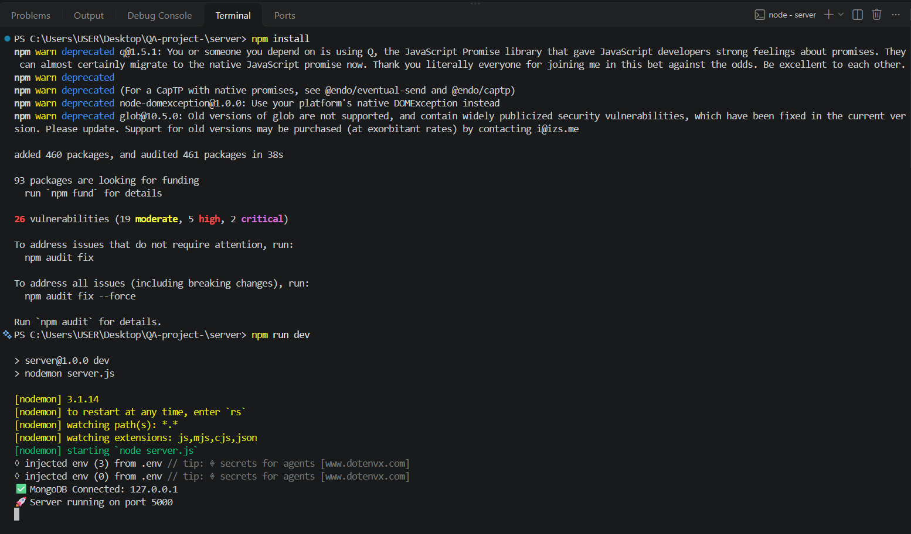
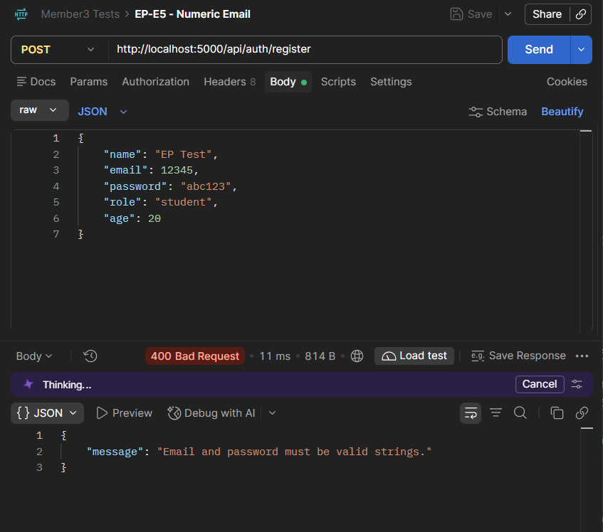
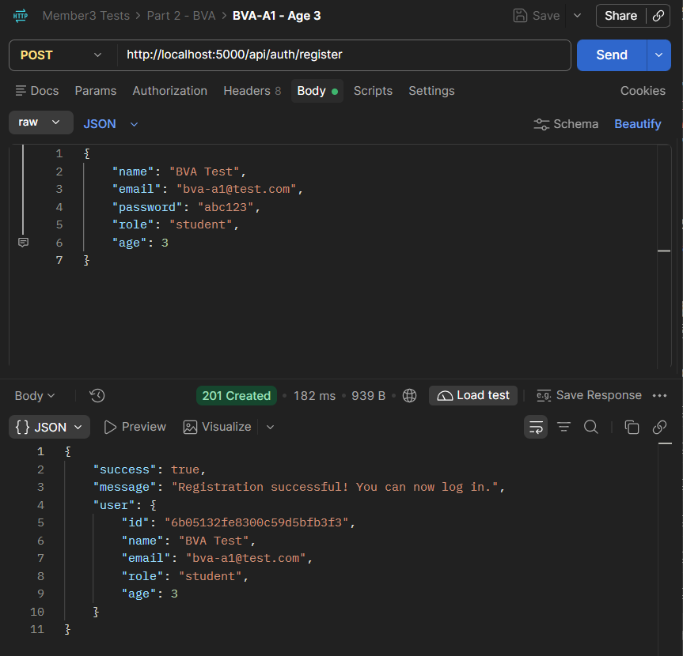
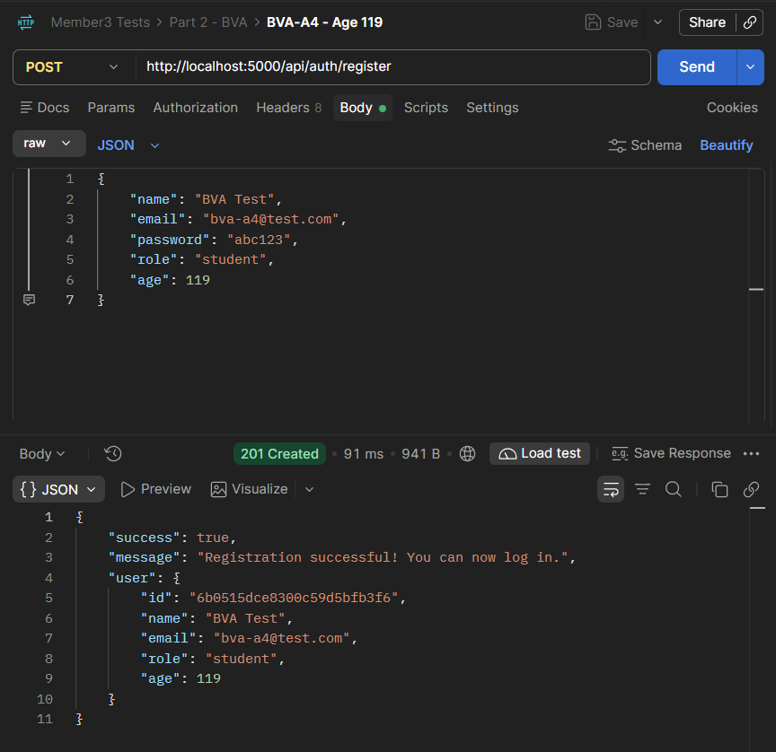
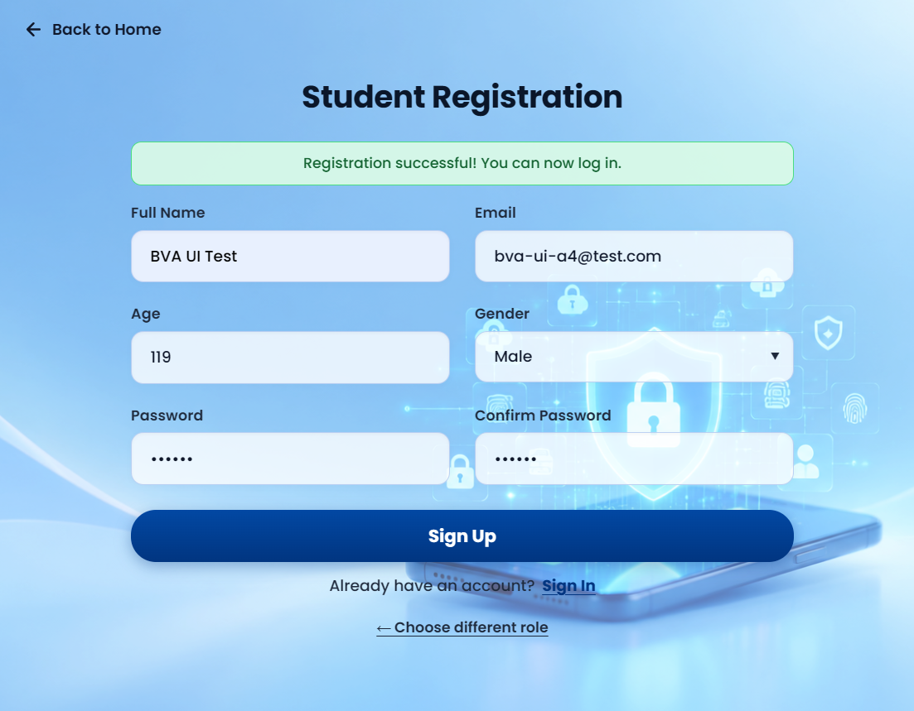
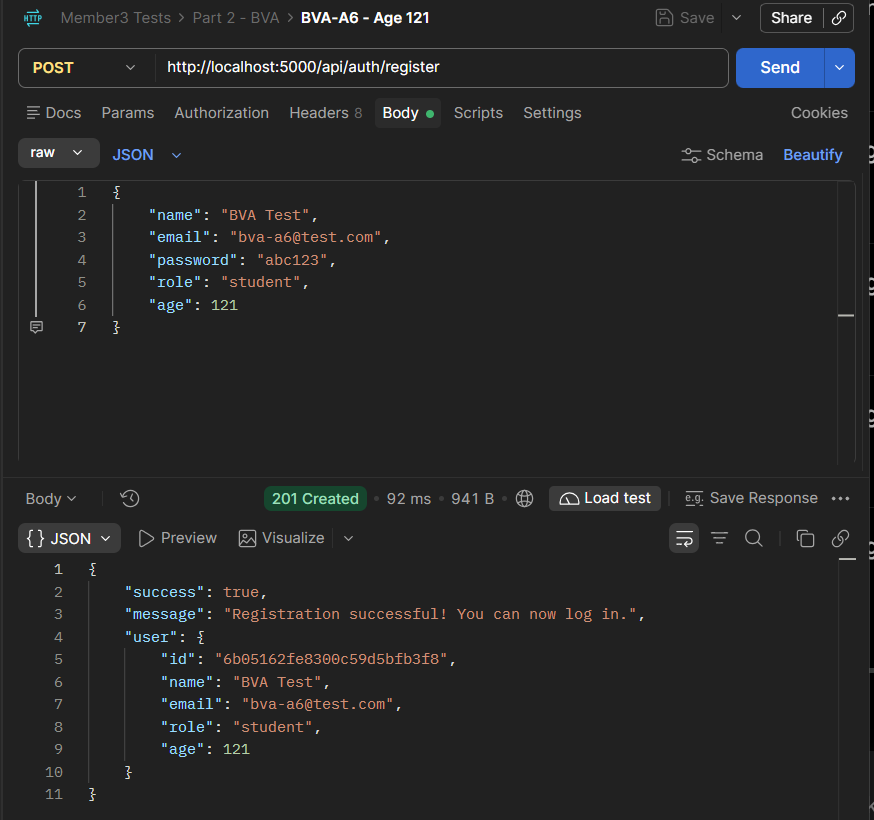
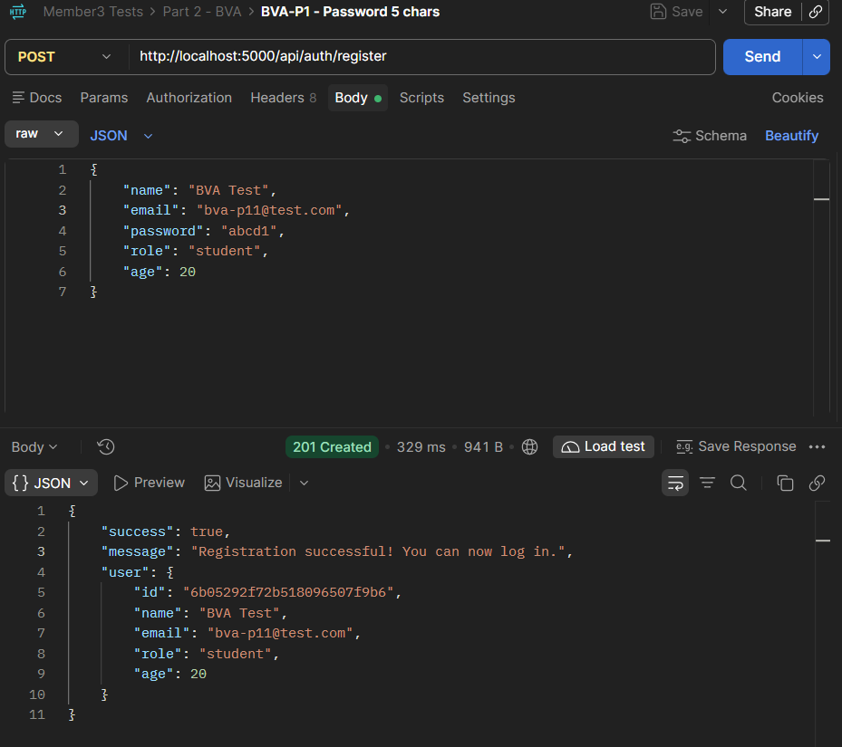
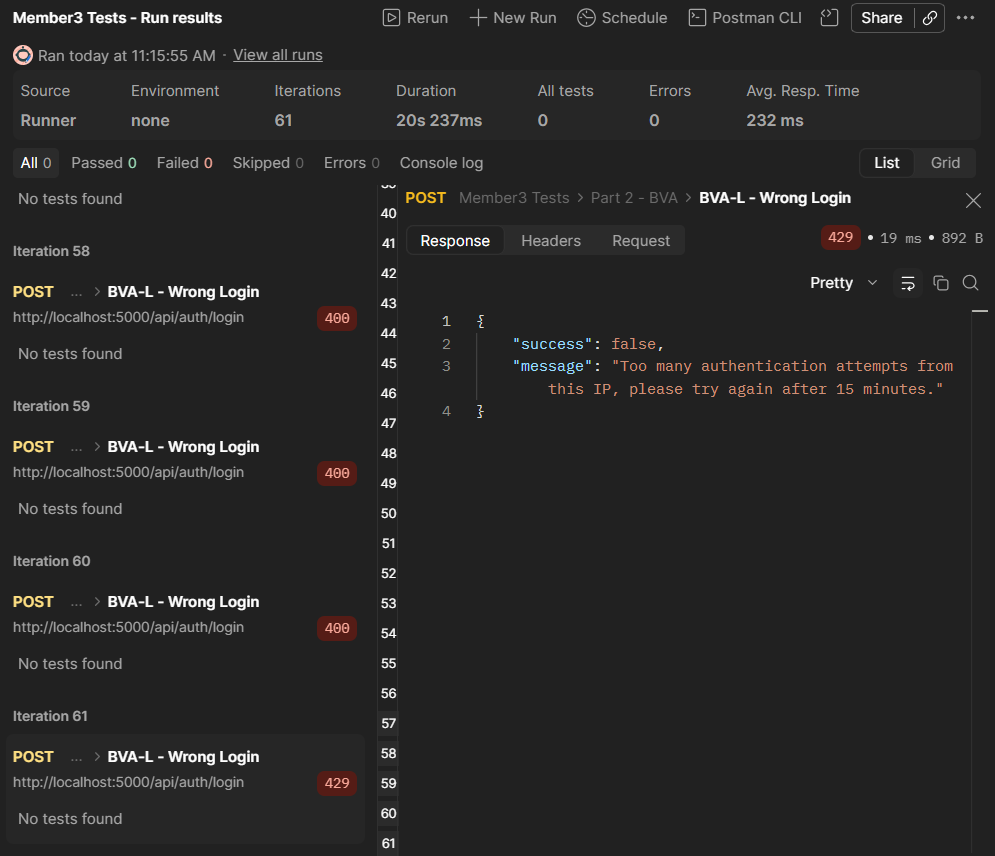

# Member 3 – Black-Box Testing & Defect Tracking

## Section 3.3: Black-Box Testing (LO-2)

### Test Environment
- OS: Windows 11, Browser: Chrome
- Backend: Node.js + Express on http://localhost:5000 (DB: cylixlab_test)
- Frontend: React + Vite on http://localhost:5173
- Tool: Postman
- Evidence:  

### 1. Equivalence Partitioning (EP)
Endpoint: `POST /api/auth/register`
Tool: Postman (Body → raw → JSON). Only one field is changed per test; all other fields stay valid.

#### Field 1: Email
| TC ID | Class | Input | Expected | Actual | Status |
|---|---|---|---|---|---|
| EP-E1 | Valid format | ep3@test.com | 201 Created | 201 Created – Registration successful | Pass |
| EP-E2 | Invalid – missing @ | eptst.com | 400 Bad Request | 201 Created – Registration successful | Fail |
| EP-E3 | Invalid – missing domain | usr@.com | 400 Bad Request | 201 Created – Registration successful | Fail |
| EP-E4 | Invalid – empty | "" | 400 Bad Request | 400 Bad Request – Email and password must be valid strings | Pass |
| EP-E5 | Invalid – not a string | 12345 | 400 Bad Request | 400 Bad Request – Email and password must be valid strings | Pass |

**EP-E1 – Valid email (Pass)**

**EP-E2 – Email without @ (Fail)**

**EP-E3 – Email without domain (Fail)**

**EP-E4 – Empty email (Pass)**

**EP-E5 – Numeric email (Pass)**

#### Field 2: Password
| TC ID | Class | Input | Expected | Actual | Status |
|---|---|---|---|---|---|
| EP-P1 | Valid – 6 or more chars | abc123 | 201 Created | 201 Created – Registration successful | Pass |
| EP-P2 | Invalid – too short (1–5 chars) | a1 | 400 Bad Request | 201 Created – Registration successful | Fail |
| EP-P3 | Invalid – empty | "" | 400 Bad Request | 400 Bad Request – Email and password must be valid strings | Pass |

**EP-P1 – Valid password (Pass)**

**EP-P2 – Short password (Fail)**

**EP-P3 – Empty password (Pass)**

#### Field 3: Role
| TC ID | Class | Input | Expected | Actual | Status |
|---|---|---|---|---|---|
| EP-R1 | Valid – student | student | 201 Created, role = student | 201 Created – role "student" | Pass |
| EP-R2 | Valid – parent | parent | 201 Created, role = parent | 201 Created – role "parent" | Pass |
| EP-R3 | Invalid – not allowed | admin | Must not create an admin account | 201 Created – role saved as "student" (admin rejected) | Pass |
| EP-R4 | Invalid – unknown | hacker | Must not accept role "hacker" | 201 Created – role saved as "student" (hacker rejected) | Pass |

**EP-R1 – Student role (Pass)**

**EP-R2 – Parent role (Pass)**

**EP-R3 – Admin role rejected (Pass)**

**EP-R4 – Unknown role rejected (Pass)**

#### EP Summary
| Field | Test Cases | Pass | Fail |
|---|---|---|---|
| Email | 5 | 3 | 2 |
| Password | 3 | 2 | 1 |
| Role | 4 | 4 | 0 |
| **Total** | **12** | **9** | **3** |

**Defects found by EP:**
- **DEF-01:** Register API accepts an email without "@" (EP-E2). No server-side email format validation.
- **DEF-02:** Register API accepts an email without a domain (EP-E3). Same root cause as DEF-01.
- **DEF-03:** Register API accepts a password shorter than 6 characters (EP-P2). The minimum length check exists only in the frontend (`Register.jsx`), not in the backend (`authController.js`).

**Observation:** The role field is handled correctly. Any role other than `student` or `parent` is replaced with `student`, so a user cannot register as `admin`.

### 2. Boundary Value Analysis (BVA)
Boundary values are tested at min − 1, min, min + 1 and max − 1, max, max + 1.
Each value is tested on the API (Postman) and on the UI (Register page in Chrome).

#### BVA 1: Student Age (valid range 4–120)
| TC ID | Value | Boundary | Expected | Actual (API) | API Status | Actual (UI) | UI Status |
|---|---|---|---|---|---|---|---|
| BVA-A1 | 3 | Min − 1 | Rejected | 201 Created – age 3 saved | Fail | Accepted – "Registration successful!" | Fail |
| BVA-A2 | 4 | Min | Accepted | 201 Created – age 4 saved | Pass | Accepted – "Registration successful!" | Pass |
| BVA-A3 | 5 | Min + 1 | Accepted | 201 Created – age 5 saved | Pass | Accepted – "Registration successful!" | Pass |
| BVA-A4 | 119 | Max − 1 | Accepted | 201 Created – age 119 saved | Pass | Accepted – "Registration successful!" | Pass |
| BVA-A5 | 120 | Max | Accepted | 201 Created – age 120 saved | Pass | Accepted – "Registration successful!" | Pass |
| BVA-A6 | 121 | Max + 1 | Rejected | 201 Created – age 121 saved | Fail | Accepted – "Registration successful!" | Fail |

**BVA-A1 – Age 3 (API, Fail)**

**BVA-A1 – Age 3 (UI, Fail)**

**BVA-A2 – Age 4 (API, Pass)**

**BVA-A2 – Age 4 (UI, Pass)**

**BVA-A3 – Age 5 (API, Pass)**

**BVA-A3 – Age 5 (UI, Pass)**

**BVA-A4 – Age 119 (API, Pass)**

**BVA-A4 – Age 119 (UI, Pass)**

**BVA-A5 – Age 120 (API, Pass)**

**BVA-A5 – Age 120 (UI, Pass)**

**BVA-A6 – Age 121 (API, Fail)**

**BVA-A6 – Age 121 (UI, Fail)**

#### BVA 2: Password Length (minimum 6 characters)
| TC ID | Value | Length | Expected | Actual (API) | API Status | Actual (UI) | UI Status |
|---|---|---|---|---|---|---|---|
| BVA-P1 | abcd1 | 5 (Min − 1) | Rejected | 201 Created – Registration successful | Fail | Rejected – "Password must be at least 6 characters." | Pass |
| BVA-P2 | abcd12 | 6 (Min) | Accepted | 201 Created – Registration successful | Pass | Accepted – "Registration successful!" | Pass |
| BVA-P3 | abcd123 | 7 (Min + 1) | Accepted | 201 Created – Registration successful | Pass | Accepted – "Registration successful!" | Pass |

**BVA-P1 – 5 characters (API, Fail)**

**BVA-P1 – 5 characters (UI, Pass)**

**BVA-P2 – 6 characters (API, Pass)**

**BVA-P2 – 6 characters (UI, Pass)**

**BVA-P3 – 7 characters (API, Pass)**

**BVA-P3 – 7 characters (UI, Pass)**

#### BVA 3: Login Rate Limit (maximum 60 attempts per 15 minutes per IP)
Tool: Postman Collection Runner – `POST /api/auth/login` with a wrong password, 61 iterations, 0 ms delay (server restarted first so the counter starts at 0).

| TC ID | Attempt No. | Boundary | Expected | Actual | Status |
|---|---|---|---|---|---|
| BVA-L1 | 59 | Max − 1 | 400 Invalid Credentials | 400 – Invalid Credentials | Pass |
| BVA-L2 | 60 | Max | 400 Invalid Credentials | 400 – Invalid Credentials | Pass |
| BVA-L3 | 61 | Max + 1 | 429 Too Many Requests | 429 – Too many authentication attempts from this IP, please try again after 15 minutes. | Pass |

**BVA-L2 – Attempt 60 returns 400 (Pass)**

**BVA-L3 – Attempt 61 returns 429 (Pass)**

#### BVA Summary
| Feature | Checks | Pass | Fail |
|---|---|---|---|
| Age – API | 6 | 4 | 2 |
| Age – UI | 6 | 4 | 2 |
| Password – API | 3 | 2 | 1 |
| Password – UI | 3 | 3 | 0 |
| Login rate limit | 3 | 3 | 0 |
| **Total** | **21** | **16** | **5** |

**Defects found by BVA:**
- **DEF-04:** Age outside the valid range 4–120 (3 and 121) is accepted by both the UI and the API. The age input has `min="4" max="120"`, but the form uses `noValidate` and the code only checks `age <= 0`. The backend has no age range check.
- **DEF-03 (confirmed again):** The API accepts a 5-character password (BVA-P1), while the UI correctly rejects it. This confirms that password length is validated only on the client side.

**Observation:** The login rate limiter works exactly at its boundary. Attempts 1–60 are processed, and attempt 61 is blocked with HTTP 429.