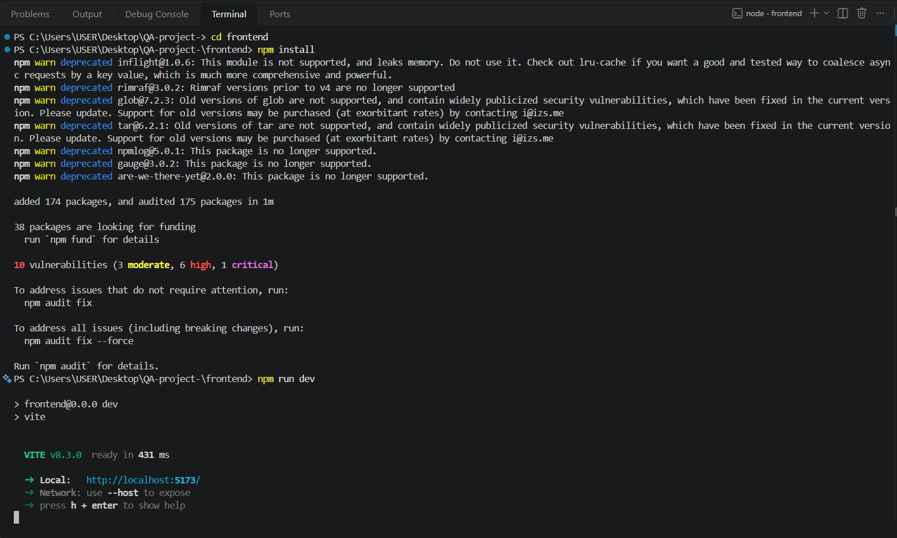

# Member 3 – Black-Box Testing & Defect Tracking

## Section 3.3: Black-Box Testing (LO-2)

### Test Environment
- OS: Windows 11, Browser: Chrome
- Backend: Node.js + Express on http://localhost:5000 (DB: cylixlab_test)
- Frontend: React + Vite on http://localhost:5173
- Tool: Postman
- Evidence:  

### 1. Equivalence Partitioning (EP)
Endpoint: `POST /api/auth/register`

#### Field 1: Email
| TC ID | Class | Input | Expected | Actual | Status |
|---|---|---|---|---|---|
| EP-E1 | Valid format | ep1@test.com | 201 Created | | |
| EP-E2 | Missing @ | eptest.com | 400 | | |
| EP-E3 | Invalid domain | user@.com | 400 | | |
| EP-E4 | Empty | "" | 400 | | |
| EP-E5 | Not a string | 12345 | 400 | | |

#### Field 2: Password
| TC ID | Class | Input | Expected | Actual | Status |
|---|---|---|---|---|---|
| EP-P1 | Valid (>= 6 chars) | abc123 | 201 | | |
| EP-P2 | Too short (1-5) | a1 | 400 | | |
| EP-P3 | Empty | "" | 400 | | |

#### Field 3: Role
| TC ID | Class | Input | Expected | Actual | Status |
|---|---|---|---|---|---|
| EP-R1 | Valid student | student | 201, role=student | | |
| EP-R2 | Valid parent | parent | 201, role=parent | | |
| EP-R3 | Not allowed | admin | not created as admin | | |
| EP-R4 | Unknown | hacker | not accepted as "hacker" | | |