# Member 3 – Black-Box Testing & Defect Tracking

## Section 3.3: Black-Box Testing (LO-2)

### Test Environment
- OS: Windows 11, Browser: Chrome
- Backend: Node.js + Express on http://localhost:5000 (DB: cylixlab_test)
- Frontend: React + Vite on http://localhost:5173
- Tool: Postman
- Evidence:  

### 1. Equivalence Partitioning (EP)
Endpoint: `POST /api/auth/register`
Tool: Postman (Body → raw → JSON). Only one field is changed per test; all other fields stay valid.

#### Field 1: Email
| TC ID | Class | Input | Expected | Actual | Status |
|---|---|---|---|---|---|
| EP-E1 | Valid format | ep3@test.com | 201 Created | 201 Created – Registration successful | Pass |
| EP-E2 | Invalid – missing @ | eptst.com | 400 Bad Request | 201 Created – Registration successful | Fail |
| EP-E3 | Invalid – missing domain | usr@.com | 400 Bad Request | 201 Created – Registration successful | Fail |
| EP-E4 | Invalid – empty | "" | 400 Bad Request | 400 Bad Request – Email and password must be valid strings | Pass |
| EP-E5 | Invalid – not a string | 12345 | 400 Bad Request | 400 Bad Request – Email and password must be valid strings | Pass |

**EP-E1 – Valid email (Pass)**
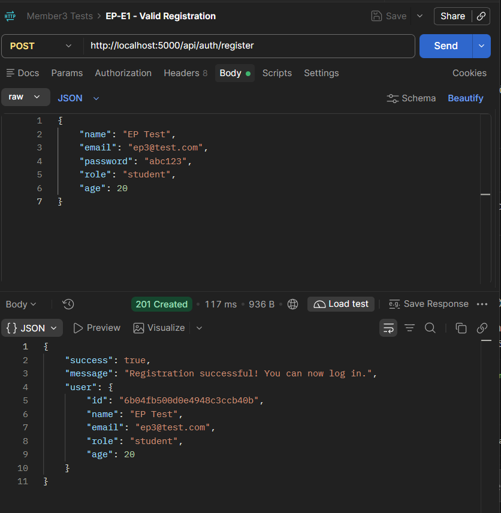

**EP-E2 – Email without @ (Fail)**
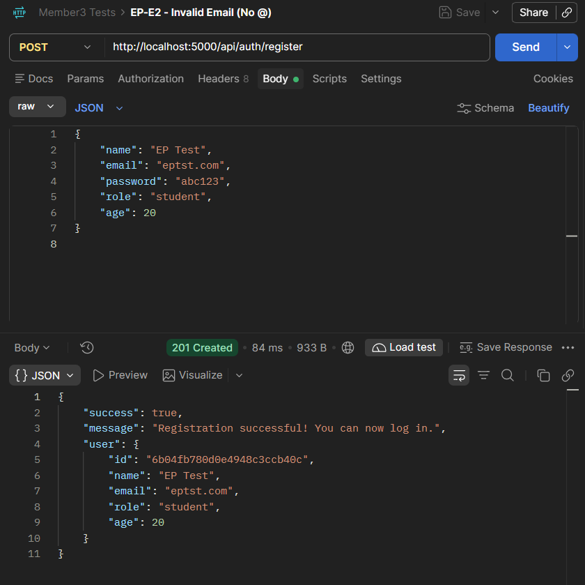

**EP-E3 – Email without domain (Fail)**
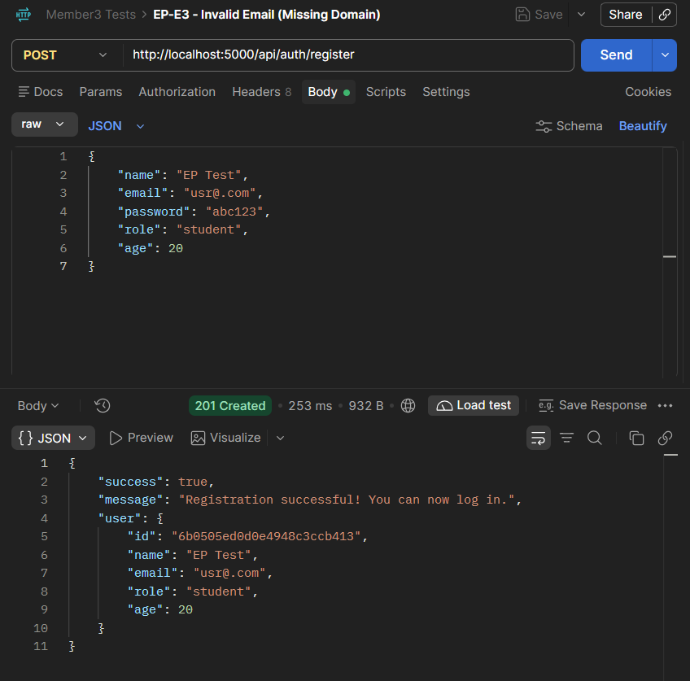

**EP-E4 – Empty email (Pass)**
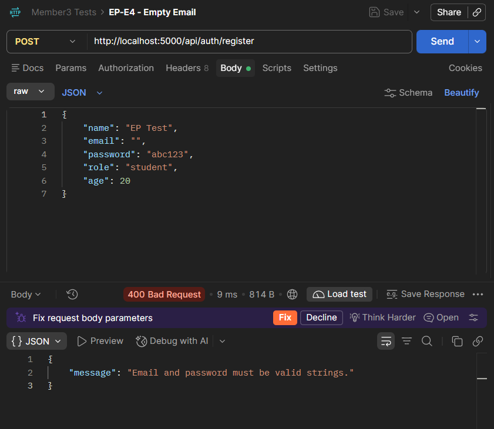

**EP-E5 – Numeric email (Pass)**


#### Field 2: Password
| TC ID | Class | Input | Expected | Actual | Status |
|---|---|---|---|---|---|
| EP-P1 | Valid – 6 or more chars | abc123 | 201 Created | 201 Created – Registration successful | Pass |
| EP-P2 | Invalid – too short (1–5 chars) | a1 | 400 Bad Request | 201 Created – Registration successful | Fail |
| EP-P3 | Invalid – empty | "" | 400 Bad Request | 400 Bad Request – Email and password must be valid strings | Pass |

**EP-P1 – Valid password (Pass)**


**EP-P2 – Short password (Fail)**
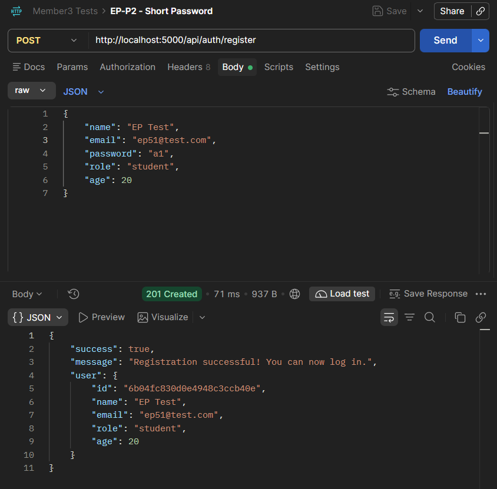

**EP-P3 – Empty password (Pass)**
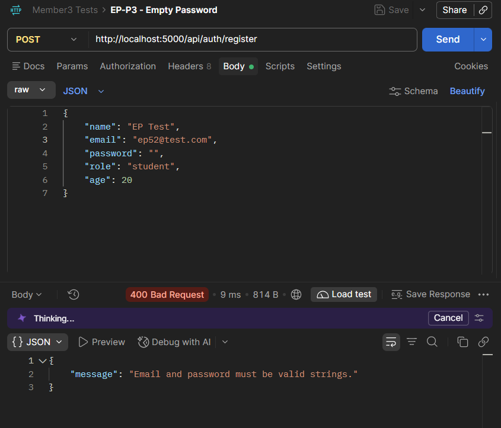

#### Field 3: Role
| TC ID | Class | Input | Expected | Actual | Status |
|---|---|---|---|---|---|
| EP-R1 | Valid – student | student | 201 Created, role = student | 201 Created – role "student" | Pass |
| EP-R2 | Valid – parent | parent | 201 Created, role = parent | 201 Created – role "parent" | Pass |
| EP-R3 | Invalid – not allowed | admin | Must not create an admin account | 201 Created – role saved as "student" (admin rejected) | Pass |
| EP-R4 | Invalid – unknown | hacker | Must not accept role "hacker" | 201 Created – role saved as "student" (hacker rejected) | Pass |

**EP-R1 – Student role (Pass)**


**EP-R2 – Parent role (Pass)**


**EP-R3 – Admin role rejected (Pass)**


**EP-R4 – Unknown role rejected (Pass)**
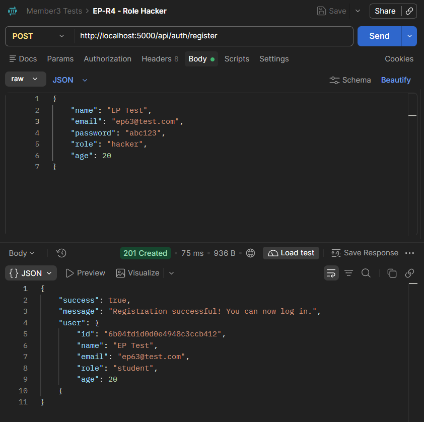

#### EP Summary
| Field | Test Cases | Pass | Fail |
|---|---|---|---|
| Email | 5 | 3 | 2 |
| Password | 3 | 2 | 1 |
| Role | 4 | 4 | 0 |
| **Total** | **12** | **9** | **3** |

**Defects found by EP:**
- **DEF-01:** Register API accepts an email without "@" (EP-E2). No server-side email format validation.
- **DEF-02:** Register API accepts an email without a domain (EP-E3). Same root cause as DEF-01.
- **DEF-03:** Register API accepts a password shorter than 6 characters (EP-P2). The minimum length check exists only in the frontend (`Register.jsx`), not in the backend (`authController.js`).

**Observation:** The role field is handled correctly. Any role other than `student` or `parent` is replaced with `student`, so a user cannot register as `admin`.

### 2. Boundary Value Analysis (BVA)
Boundary values are tested at min − 1, min, min + 1 and max − 1, max, max + 1.
Each value is tested on the API (Postman) and on the UI (Register page in Chrome).


#### BVA 1: Student Age (valid range 4–120)
| TC ID | Value | Boundary | Expected | Actual (API) | API Status | Actual (UI) | UI Status |
|---|---|---|---|---|---|---|---|
| BVA-A1 | 3 | Min − 1 | Rejected | 201 Created – age 3 saved | Fail | Accepted – "Registration successful!" | Fail |
| BVA-A2 | 4 | Min | Accepted | 201 Created – age 4 saved | Pass | Accepted – "Registration successful!" | Pass |
| BVA-A3 | 5 | Min + 1 | Accepted | 201 Created – age 5 saved | Pass | Accepted – "Registration successful!" | Pass |
| BVA-A4 | 119 | Max − 1 | Accepted | 201 Created – age 119 saved | Pass | Accepted – "Registration successful!" | Pass |
| BVA-A5 | 120 | Max | Accepted | 201 Created – age 120 saved | Pass | Accepted – "Registration successful!" | Pass |
| BVA-A6 | 121 | Max + 1 | Rejected | 201 Created – age 121 saved | Fail | Accepted – "Registration successful!" | Fail |

**BVA-A1 – Age 3 (API, Fail)**


**BVA-A1 – Age 3 (UI, Fail)**


**BVA-A2 – Age 4 (API, Pass)**
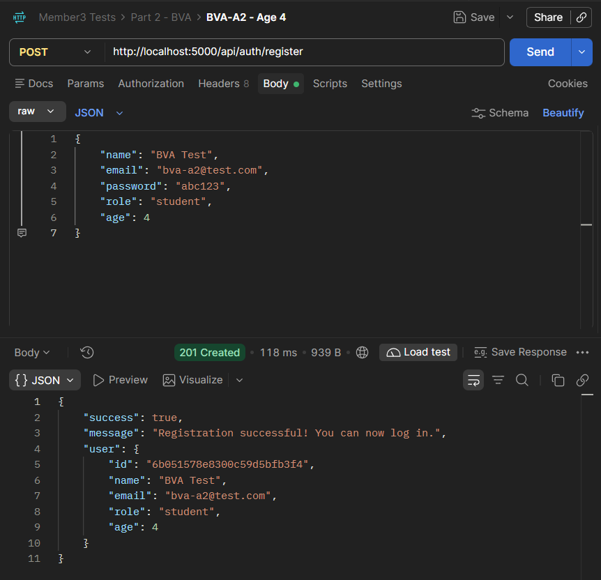

**BVA-A2 – Age 4 (UI, Pass)**
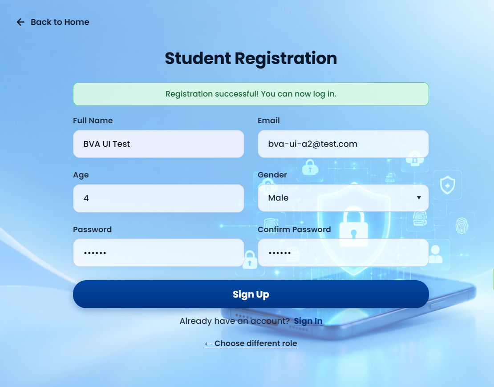

**BVA-A3 – Age 5 (API, Pass)**
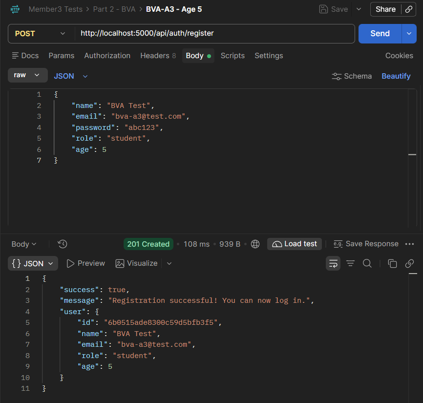

**BVA-A3 – Age 5 (UI, Pass)**
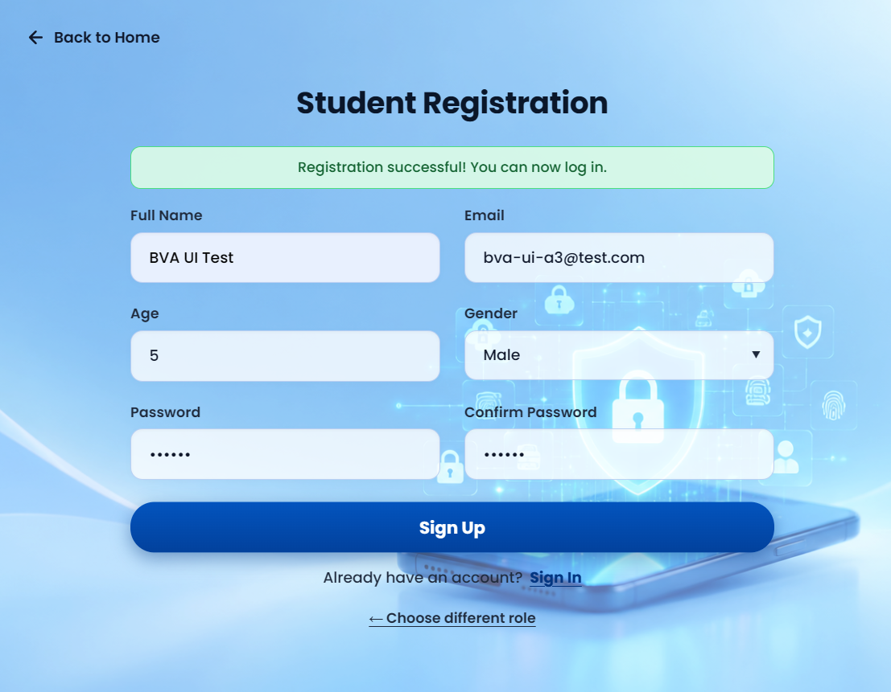

**BVA-A4 – Age 119 (API, Pass)**


**BVA-A4 – Age 119 (UI, Pass)**


**BVA-A5 – Age 120 (API, Pass)**
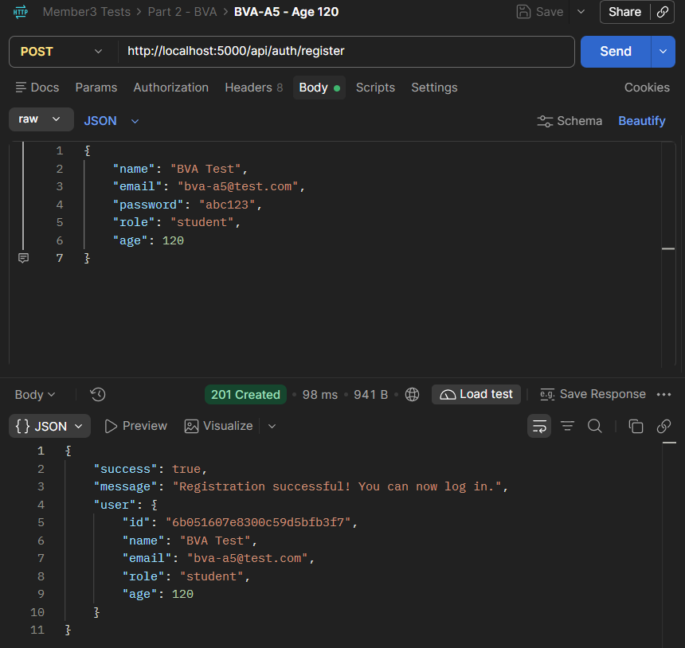

**BVA-A5 – Age 120 (UI, Pass)**
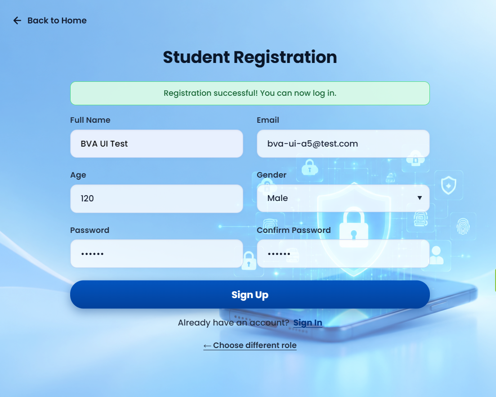

**BVA-A6 – Age 121 (API, Fail)**


**BVA-A6 – Age 121 (UI, Fail)**
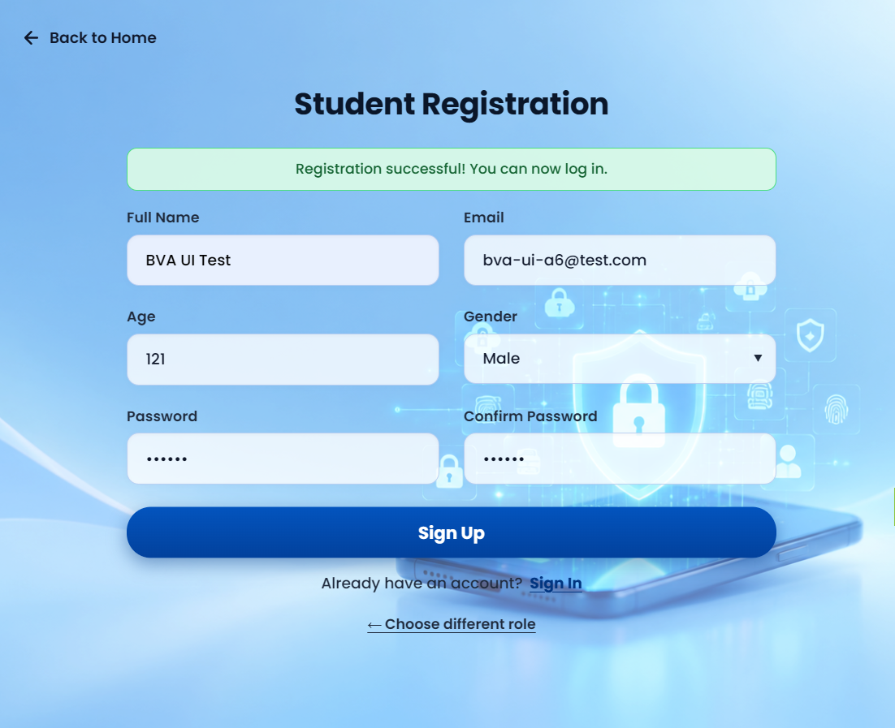

#### BVA 2: Password Length (minimum 6 characters)
| TC ID | Value | Length | Expected | Actual (API) | API Status | Actual (UI) | UI Status |
|---|---|---|---|---|---|---|---|
| BVA-P1 | abcd1 | 5 (Min − 1) | Rejected | 201 Created – Registration successful | Fail | Rejected – "Password must be at least 6 characters." | Pass |
| BVA-P2 | abcd12 | 6 (Min) | Accepted | 201 Created – Registration successful | Pass | Accepted – "Registration successful!" | Pass |
| BVA-P3 | abcd123 | 7 (Min + 1) | Accepted | 201 Created – Registration successful | Pass | Accepted – "Registration successful!" | Pass |

**BVA-P1 – 5 characters (API, Fail)**


**BVA-P1 – 5 characters (UI, Pass)**
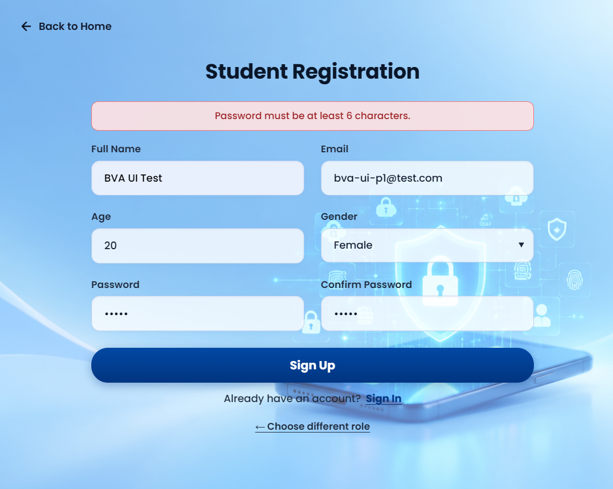

**BVA-P2 – 6 characters (API, Pass)**


**BVA-P2 – 6 characters (UI, Pass)**


**BVA-P3 – 7 characters (API, Pass)**
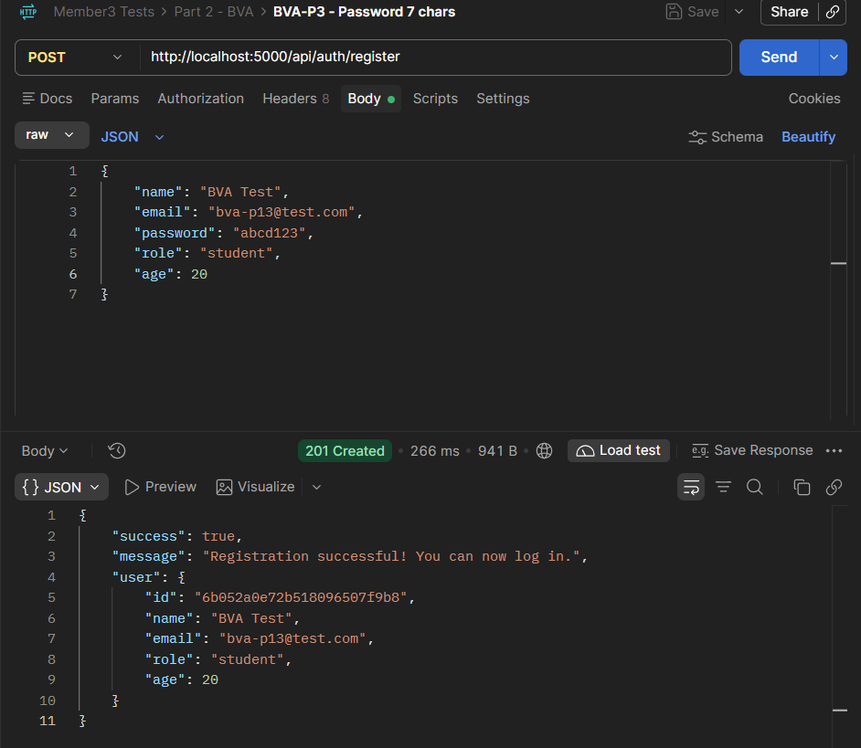

**BVA-P3 – 7 characters (UI, Pass)**
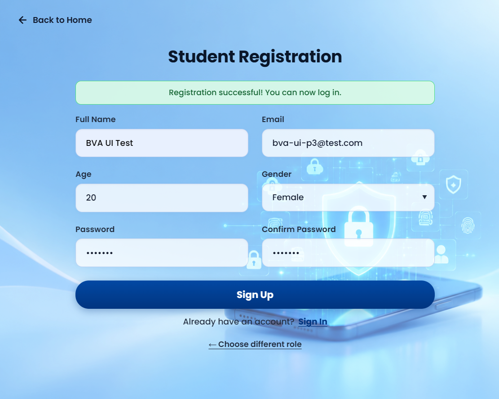

#### BVA 3: Login Rate Limit (maximum 60 attempts per 15 minutes per IP)
Tool: Postman Collection Runner – `POST /api/auth/login` with a wrong password, 61 iterations, 0 ms delay (server restarted first so the counter starts at 0).

| TC ID | Attempt No. | Boundary | Expected | Actual | Status |
|---|---|---|---|---|---|
| BVA-L1 | 59 | Max − 1 | 400 Invalid Credentials | 400 – Invalid Credentials | Pass |
| BVA-L2 | 60 | Max | 400 Invalid Credentials | 400 – Invalid Credentials | Pass |
| BVA-L3 | 61 | Max + 1 | 429 Too Many Requests | 429 – Too many authentication attempts from this IP, please try again after 15 minutes. | Pass |

**BVA-L2 – Attempt 60 returns 400 (Pass)**
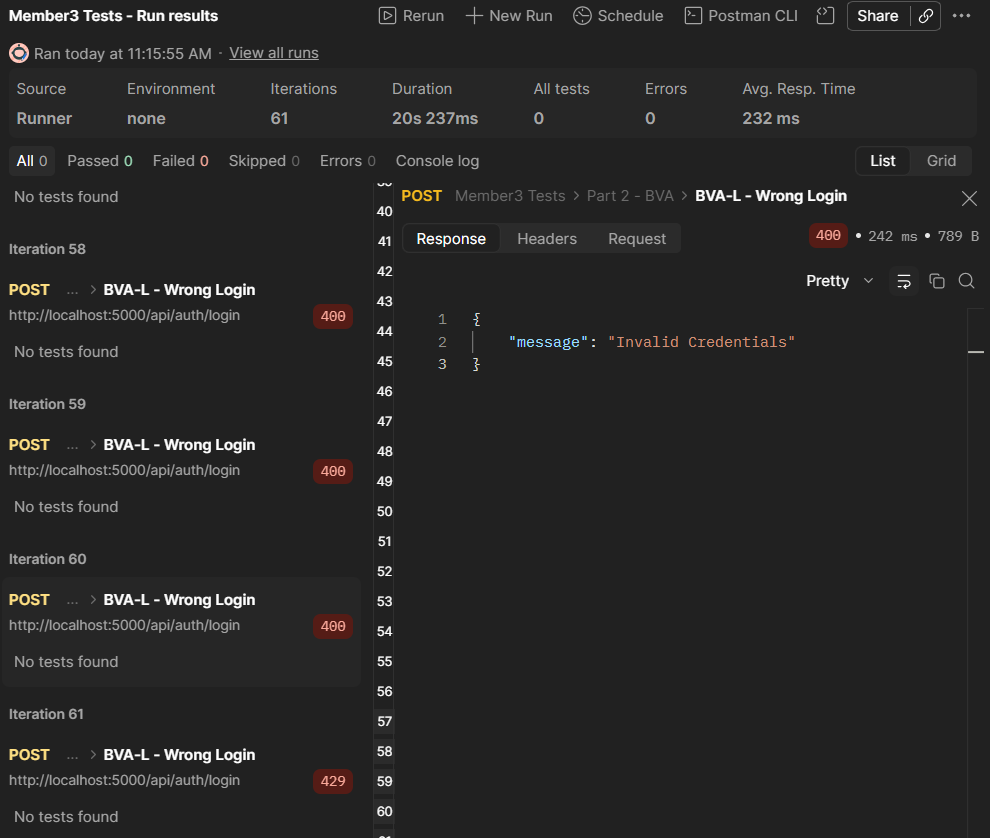

**BVA-L3 – Attempt 61 returns 429 (Pass)**


#### BVA Summary
| Feature | Checks | Pass | Fail |
|---|---|---|---|
| Age – API | 6 | 4 | 2 |
| Age – UI | 6 | 4 | 2 |
| Password – API | 3 | 2 | 1 |
| Password – UI | 3 | 3 | 0 |
| Login rate limit | 3 | 3 | 0 |
| **Total** | **21** | **16** | **5** |

**Defects found by BVA:**
- **DEF-04:** Age outside the valid range 4–120 (3 and 121) is accepted by both the UI and the API. The age input has `min="4" max="120"`, but the form uses `noValidate` and the code only checks `age <= 0`. The backend has no age range check.
- **DEF-03 (confirmed again):** The API accepts a 5-character password (BVA-P1), while the UI correctly rejects it. This confirms that password length is validated only on the client side.

**Observation:** The login rate limiter works exactly at its boundary. Attempts 1–60 are processed, and attempt 61 is blocked with HTTP 429.

### 3. Decision Table Testing

#### Feature: Update Course – `PUT /api/courses/:id` (protected by `protect` + `authorize('instructor','admin')`)

| Conditions / Actions | R1 | R2 | R3 | R4 |
|---|---|---|---|---|
| C1: Token sent? | No | Yes | Yes | Yes |
| C2: Token valid? | – | No | Yes | Yes |
| C3: Role is admin/instructor? | – | – | No (student) | Yes (admin) |
| **Expected action** | 401 Not authorized | 401 Not authorized | 403 Forbidden | 200 Course updated |
| **Actual result** | 401 – Not authorized to access this route | 401 – Not authorized to access this route | 403 – User role 'student' is not authorized to access this route | 200 – title changed to "DT Updated Title" |
| **Status** | Pass | Pass | Pass | Pass |

*Note: A dedicated test admin account was configured in the local test environment (`server/.env`) for rule R4. Production admin credentials were not used.*

**R1 – No token (Pass)**
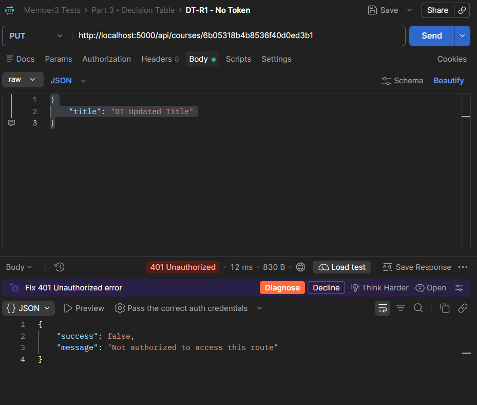

**R2 – Invalid token (Pass)**
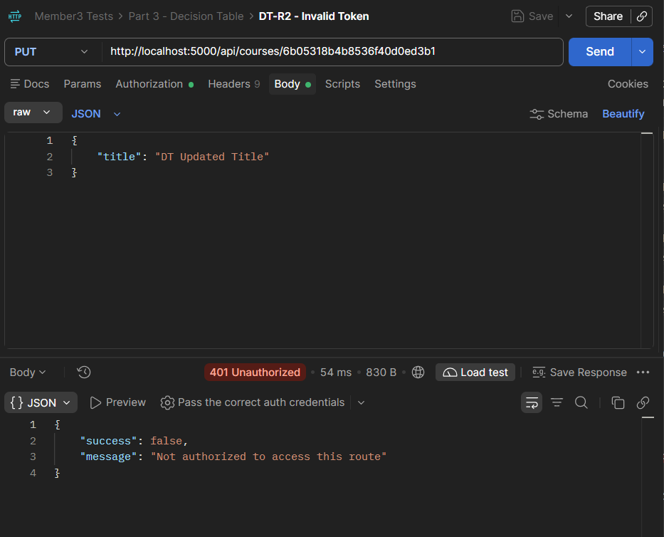

**R3 – Student token (Pass)**
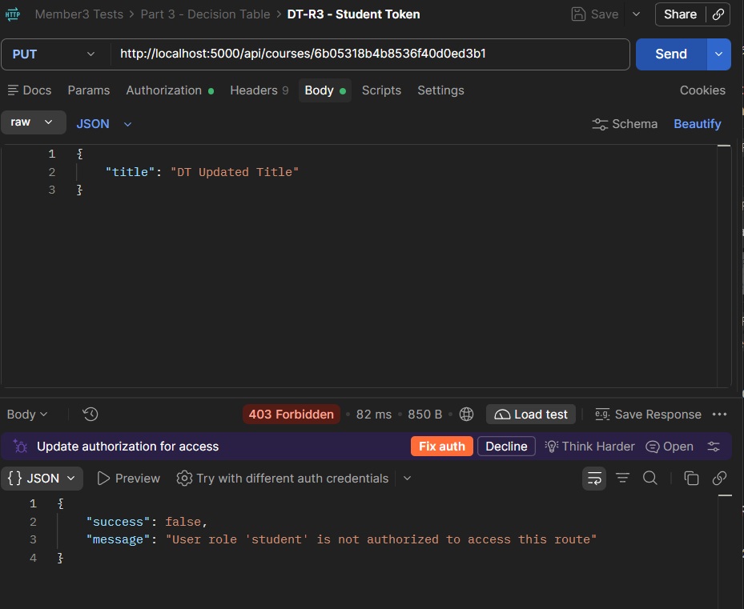

**R4 – Admin token (Pass)**
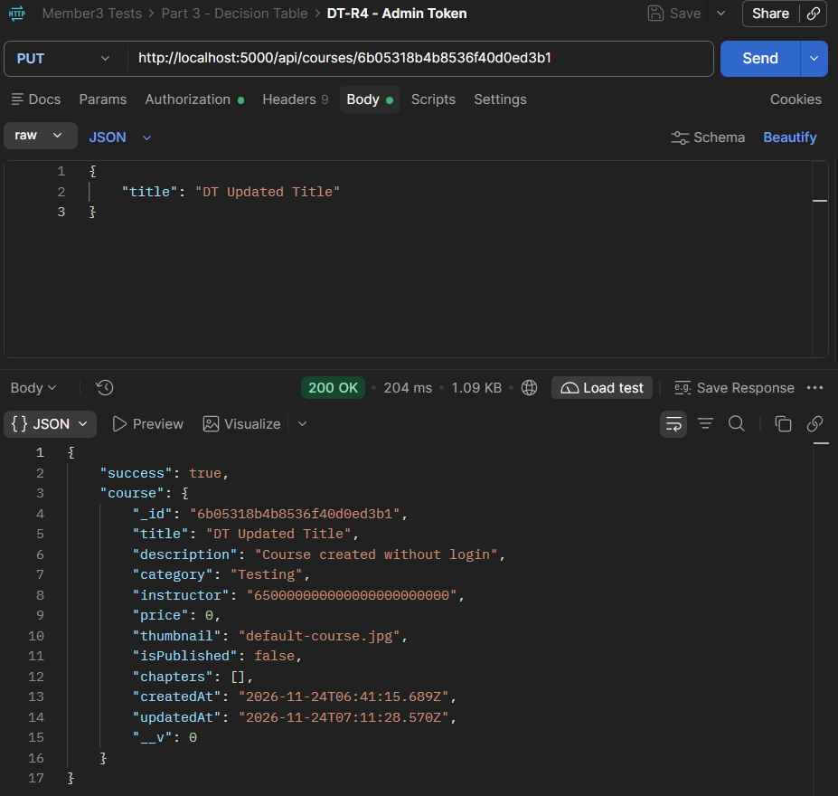

#### Additional Access-Control Rules (endpoints that should also be protected)
| Rule | Request | Token | Expected | Actual | Status |
|---|---|---|---|---|---|
| R5 | `POST /api/courses` (create course) | None | 401 Not authorized | 201 Created – "Course created successfully!" | Fail |
| R6a | `GET /api/courses/student-submissions?studentEmail=studentA@test.com` | None | Only Student A's submission | 200 OK – only Student A's submission returned | Pass |
| R6b | `GET /api/courses/student-submissions?studentEmail=.*` | None | Empty list (".*" is not a real email) | 200 OK – submissions of other students returned | Fail |

**R5 – Create course without token (Fail)**
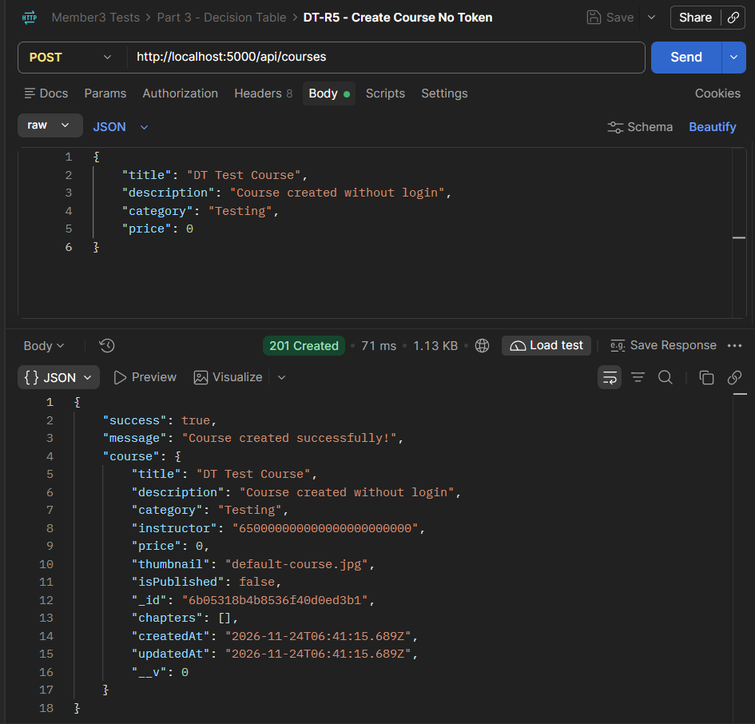

**R6a – Own submissions (Pass)**
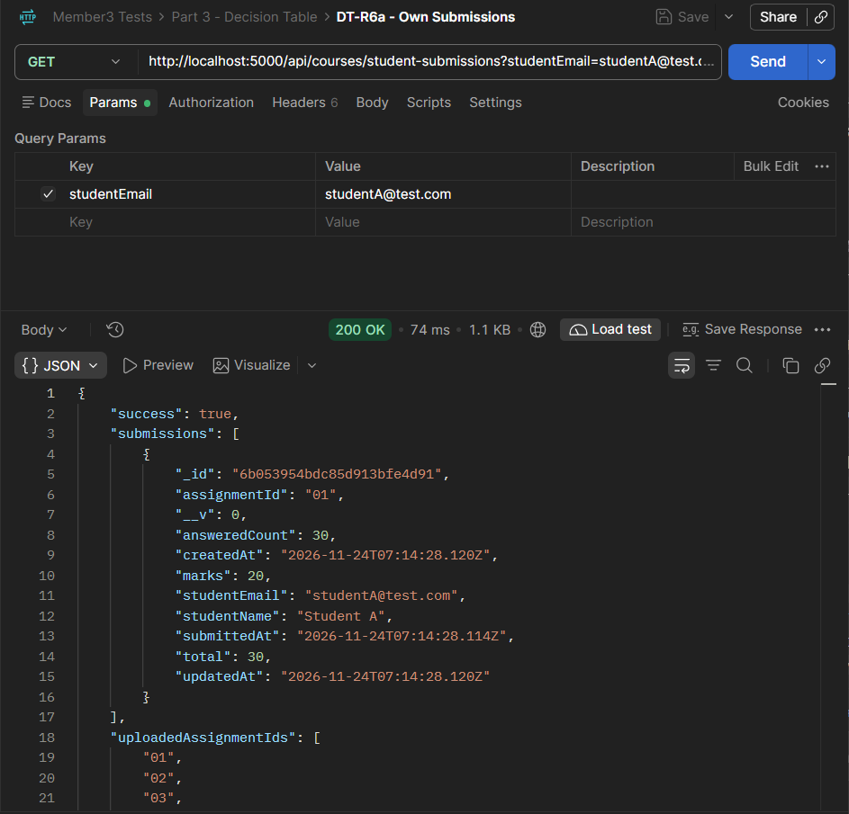

**R6b – Regex wildcard returns other students' data (Fail)**
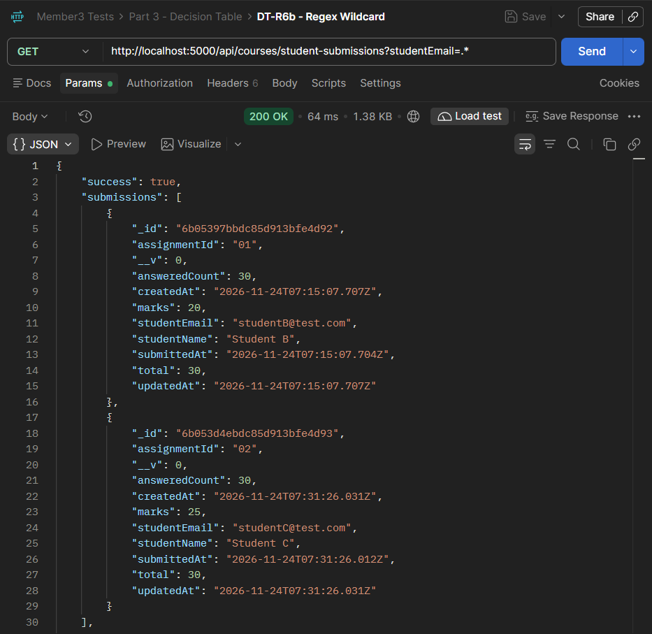

#### Decision Table Summary
| Group | Rules | Pass | Fail |
|---|---|---|---|
| Update course (R1–R4) | 4 | 4 | 0 |
| Additional rules (R5, R6a, R6b) | 3 | 1 | 2 |
| **Total** | **7** | **5** | **2** |

**Defects found by Decision Table:**
- **DEF-05 (Critical – Broken Access Control):** `POST /api/courses` has no `protect`/`authorize` middleware, so anyone can create a course without logging in (R5). PUT and DELETE on the same resource are protected correctly (R1–R4).
- **DEF-06 (Critical – Injection / Data Exposure):** `GET /api/courses/student-submissions` builds a regular expression directly from the `studentEmail` query value without escaping it. The value `.*` matches every student, and the endpoint needs no login, so any visitor can read all students' marks (R6b).

**Observation:** The update-course endpoint enforces authentication and role-based authorization correctly for all four condition combinations.

---

## Section 3.8: Defect Tracking (LO-2, LO-4)

### 1. Defect Tracking Tool and Workflow
- **Tool:** GitHub Issues in the `QA-project-` repository.
- **Labels:** GitHub Issues has only Open/Closed states, so custom labels are used to represent severity and each stage of the bug lifecycle.
  - Severity: `severity:critical`, `severity:major`, `severity:minor`
  - Lifecycle status: `status:new` → `status:assigned` → `status:in-progress` → `status:fixed` → `status:retest` → `status:closed`
- **Report format:** Every issue has severity, priority, the test case that found it, the environment, steps to reproduce, expected vs. actual result, screenshot evidence and a suspected cause.

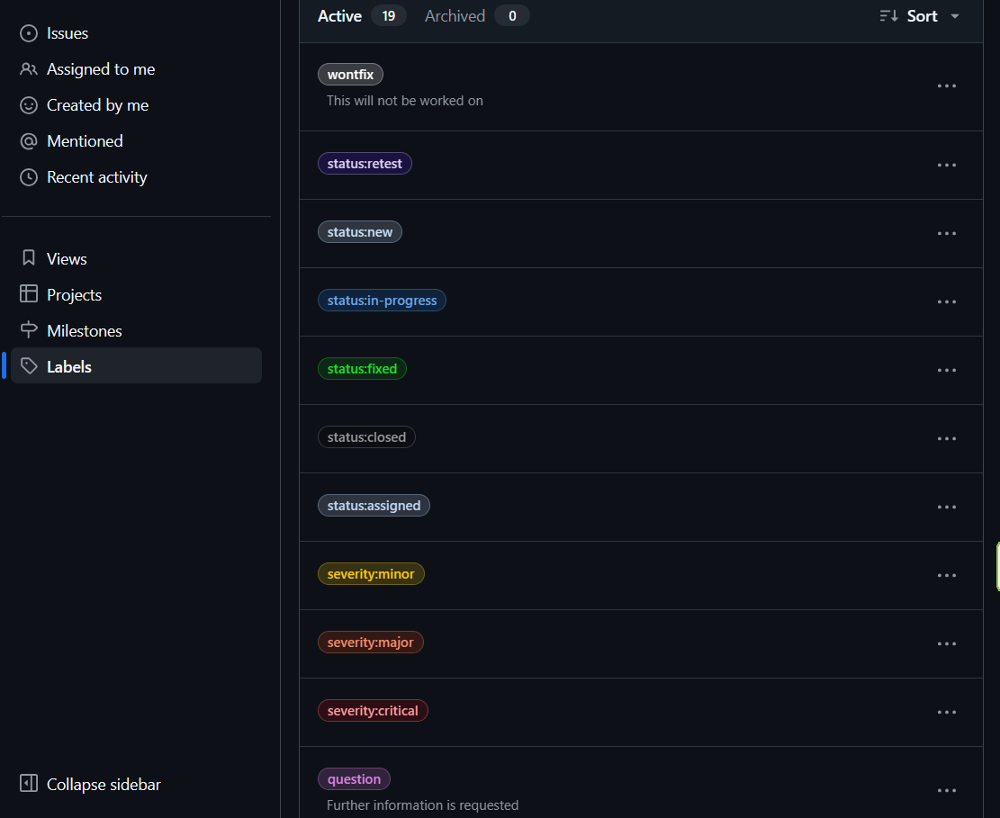

### 2. Defect Log
| Defect ID | GitHub Issue | Title | Found by | Severity | Priority | Status |
|---|---|---|---|---|---|---|
| DEF-01 | [#7](https://github.com/ravinduanushka/QA-project-/issues/7) | Register API accepts email without "@" | EP-E2 | Major | Medium | New |
| DEF-02 | [#8](https://github.com/ravinduanushka/QA-project-/issues/8) | Register API accepts email without domain | EP-E3 | Major | Medium | New |
| DEF-03 | [#9](https://github.com/ravinduanushka/QA-project-/issues/9) | Register API accepts password shorter than 6 characters | EP-P2, BVA-P1 | Major | High | New |
| DEF-04 | [#10](https://github.com/ravinduanushka/QA-project-/issues/10) | Age outside 4–120 accepted by UI and API | BVA-A1, BVA-A6 | Minor | Low | New |
| DEF-05 | [#11](https://github.com/ravinduanushka/QA-project-/issues/11) | Anyone can create a course without login | Decision Table R5 | Critical | High | New |
| DEF-06 | [#12](https://github.com/ravinduanushka/QA-project-/issues/12) | Student submissions endpoint leaks all students' marks | Decision Table R6b | Critical | High | New |

**Summary:** 6 defects – 2 Critical, 3 Major, 1 Minor.
All six defects come from missing server-side checks: input validation (DEF-01 to DEF-04) or access control and input sanitisation (DEF-05, DEF-06).

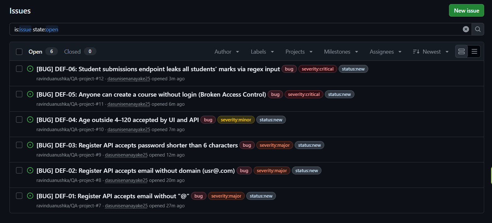

### 3. Root Cause Analysis (RCA)
Two significant defects were analysed: one Critical security defect (DEF-05) and one Major validation defect (DEF-03).

#### RCA 1: DEF-05 – Anyone can create a course without login ([#11](https://github.com/ravinduanushka/QA-project-/issues/11))

**Problem statement:** `POST /api/courses` creates a course for an anonymous user (201 Created without a token), while `PUT` and `DELETE` on the same resource correctly return 401/403.

**5 Whys**
| # | Why? | Answer |
|---|---|---|
| 1 | Why can an anonymous user create a course? | The `POST /api/courses` request is accepted without any token. |
| 2 | Why is it accepted without a token? | In `server/src/routes/courseRoutes.js`, `router.post('/', createCourse)` has no `protect` or `authorize(...)` middleware, unlike the `PUT` and `DELETE` routes. |
| 3 | Why does the controller still work without a logged-in user? | `createCourse` falls back to `req.body.instructor` or a hard-coded ID `650000000000000000000000` when `req.user` is missing, so it was written to run without authentication. |
| 4 | Why was this not noticed? | The frontend never calls `POST /api/courses`, so the endpoint is unused, leftover code. Nobody tested it, and the existing automated tests only check 401 on `/api/auth/profile`. |
| 5 | Why is there no test or review rule for it? | The team has no rule that every write endpoint (POST/PUT/DELETE) must be protected and must have an "unauthenticated → 401" test. |

**Root cause:** Missing authorization middleware on an unused endpoint, combined with no process rule or test for access control on write routes.

**Fix:**
- Add `protect, authorize('instructor', 'admin')` to `router.post('/', ...)`.
- Remove the hard-coded instructor fallback in `createCourse`, and take the instructor from `req.user.id`.
- Remove unused endpoints that the frontend does not need.

**Prevention:**
- Add a Supertest test for every write route: no token → 401, student token → 403.
- Add "every POST/PUT/DELETE route has auth middleware" to the Pull Request review checklist.
- Lesson from the Knight Capital case (2012): unused code still runs in production and can cause serious failures.

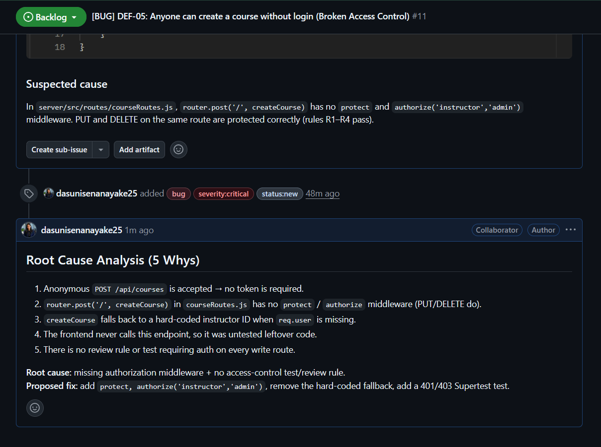

#### RCA 2: DEF-03 – Register API accepts password shorter than 6 characters ([#9](https://github.com/ravinduanushka/QA-project-/issues/9))

**Problem statement:** The register form rejects a 5-character password, but a direct API call (`POST /api/auth/register`) accepts it and creates the account.

**5 Whys**
| # | Why? | Answer |
|---|---|---|
| 1 | Why does the API accept a 5-character password? | `registerUser` in `server/src/controllers/authController.js` only checks that the password is a non-empty string. |
| 2 | Why is there no length check on the server? | The 6-character rule was implemented only in `frontend/src/components/Register.jsx` (`password.length < 6`). |
| 3 | Why only in the frontend? | Developers assumed every user registers through the UI form, so the API was treated as trusted. |
| 4 | Why was this not caught? | There are no backend tests for registration rules, and the `User` model has no `minlength` for the password. |
| 5 | Why is there no rule for this? | Requirements and acceptance criteria did not state that all input rules must be enforced on the server, and there is no shared validation layer. |

**Root cause:** Validation exists only on the client side. The server trusts input that an attacker can send directly without using the UI.

**Fix:** Add a server-side check in `registerUser`: return 400 "Password must be at least 6 characters." when `password.length < 6`.

**Prevention:**
- Validate every input on the server (for example with a shared schema using Joi or express-validator) and keep the frontend check only for user experience.
- Add API tests for the password boundaries 5 / 6 / 7 (BVA-P1 to BVA-P3) to the CI pipeline.
- Add "server-side validation" to the acceptance criteria of user stories.

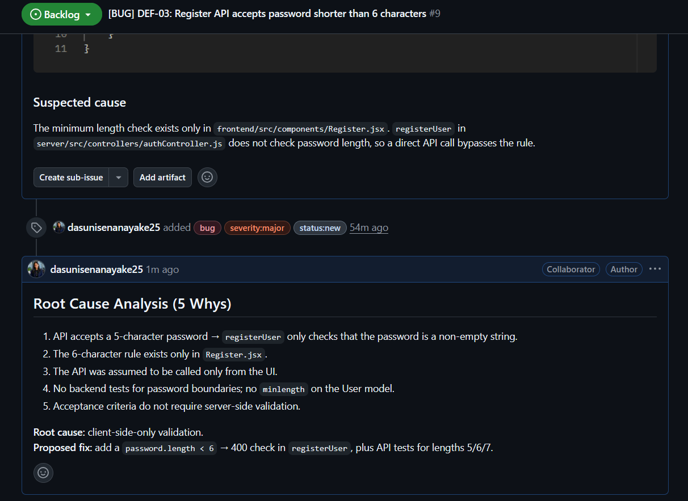

#### Fishbone (Ishikawa) Diagram – DEF-03
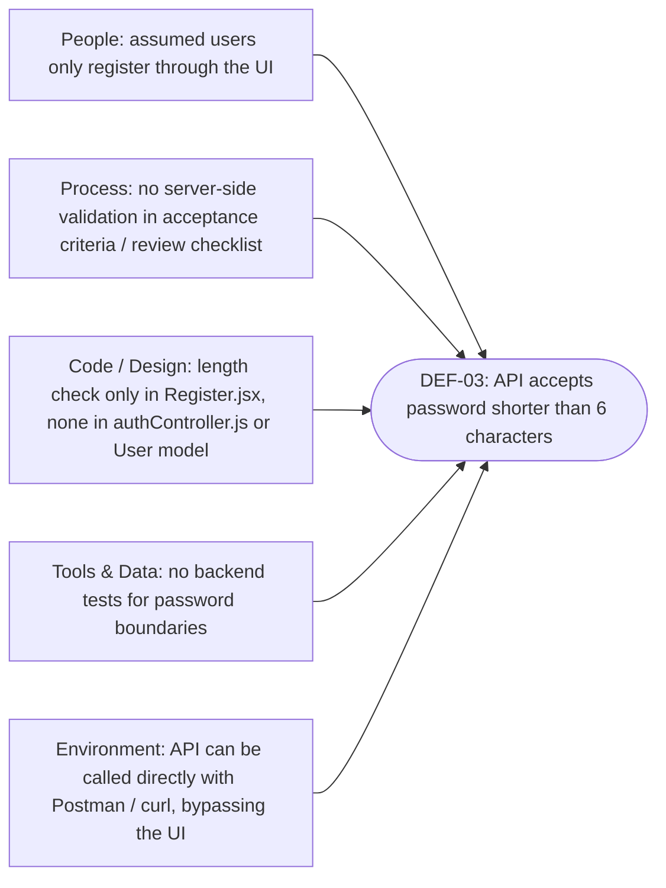
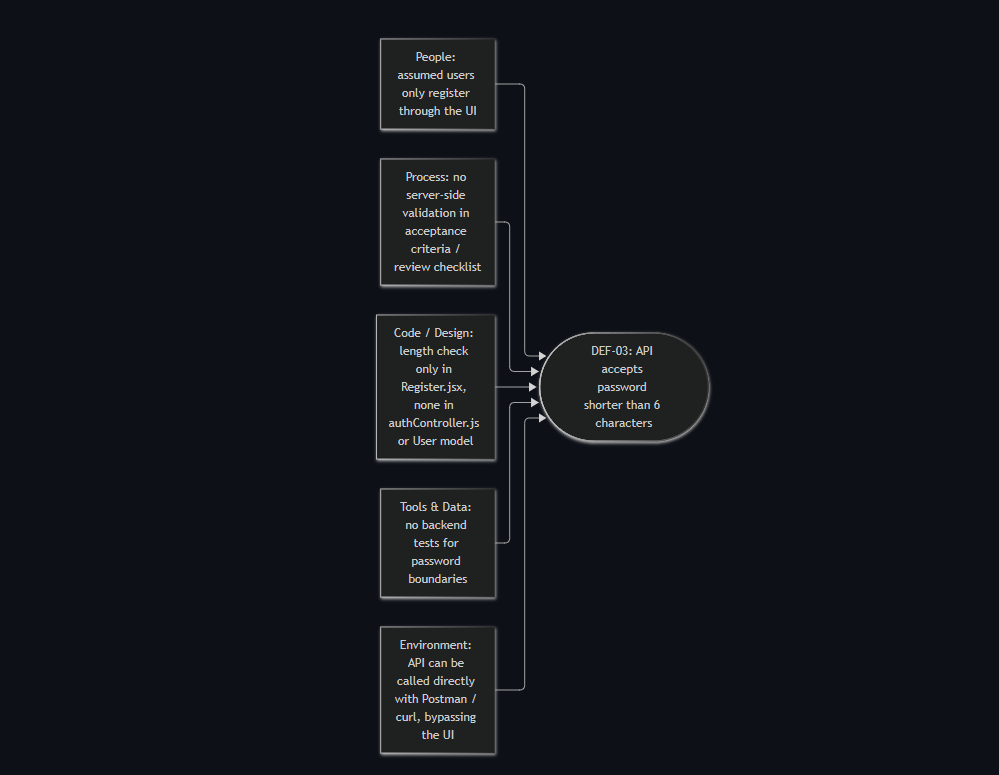

#### Common Pattern Across All Defects
All six defects share the same root cause: **the backend trusts client input.**
- Validation exists only in the UI (DEF-01 to DEF-04).
- Access control or input sanitisation is missing (DEF-05, DEF-06).

### 4. Bug Lifecycle – DEF-03 ([#9](https://github.com/ravinduanushka/QA-project-/issues/9))
DEF-03 was taken through the complete bug lifecycle. Each stage is recorded on the GitHub issue as a `status:*` label change plus a comment, so the issue timeline is the audit trail.

`New → Assigned → In Progress → Fixed → Retest (Verified) → Closed`

| Stage | Action taken | Evidence |
|---|---|---|
| 1. New | Defect found by EP-P2 / BVA-P1 and logged as issue #9 with severity, steps, expected vs. actual and screenshots. Label `status:new`. | `3.8_Lifecycle_1_New.png` |
| 2. Assigned | Issue assigned to Member 3. Label changed to `status:assigned`. | `3.8_Lifecycle_2_Assigned.png` |
| 3. In Progress | Fix started on branch `member3-blackbox-defects`. Label changed to `status:in-progress`. | `3.8_Lifecycle_3_InProgress.png` |
| 4. Fixed | Server-side check added in `registerUser` (`authController.js`): passwords shorter than 6 characters return 400. Regression tests added in `server/tests/member3.defects.test.js` (24/24 tests pass). Commit `450aaa7`. Label changed to `status:fixed`. | `3.8_Lifecycle_Fix_Tests_Pass.png`, `3.8_Lifecycle_4_Fixed.png` |
| 5. Retest (Verified) | BVA-P1 re-run: 5-character password now returns 400. BVA-P2 re-run: 6-character password still returns 201. Label changed to `status:retest`. | `3.8_Lifecycle_5_Retest_API_5chars_400.png`, `3.8_Lifecycle_5_Retest_API_6chars_201.png`, `3.8_Lifecycle_5_Retest.png` |
| 6. Closed | Pull Request with `Fixes #9` merged into `main` after the CI pipeline passed. GitHub closed the issue automatically. Label changed to `status:closed`. | `3.8_Lifecycle_6_Closed.png` |

**The fix**
```js
if (password.length < 6) {
  return res.status(400).json({ message: 'Password must be at least 6 characters.' });
}
```

**Stage 1 – New**
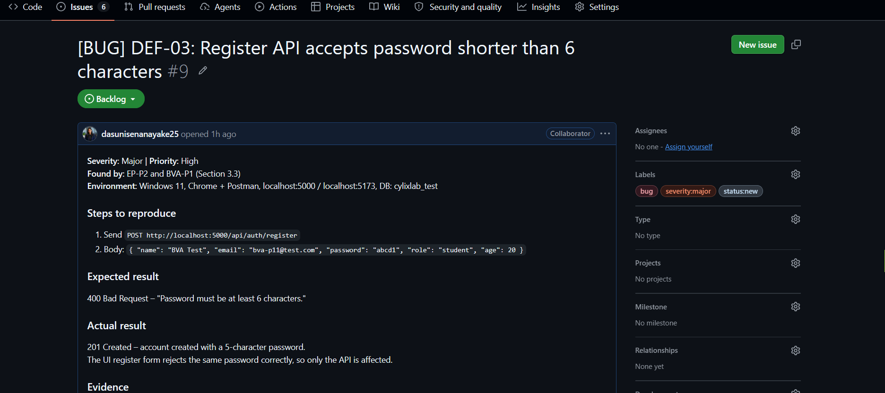

**Stage 2 – Assigned**
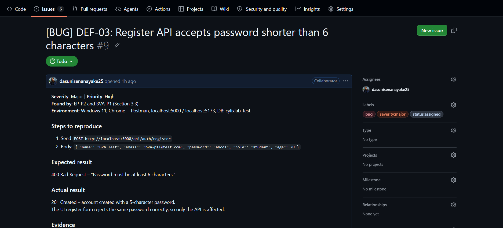

**Stage 3 – In Progress**
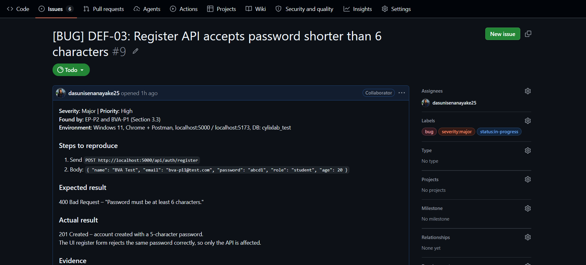

**Stage 4 – Fixed (regression tests pass)**
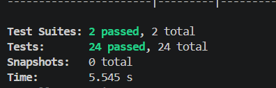
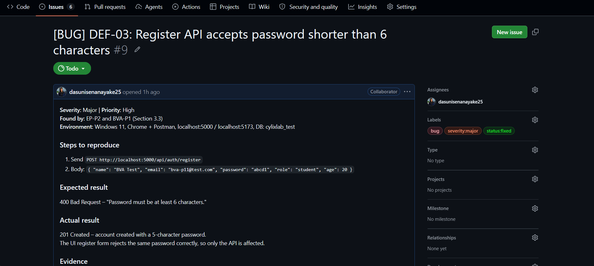

**Stage 5 – Retest (Verified)**
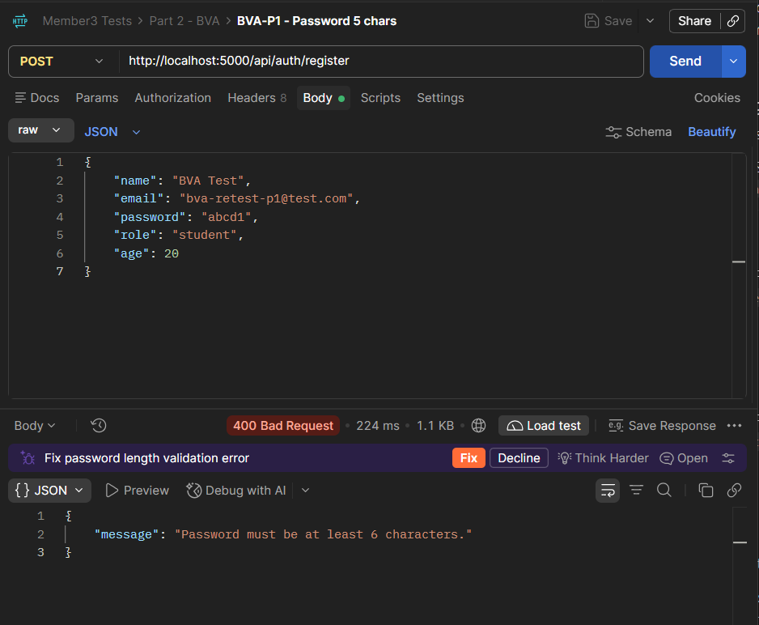
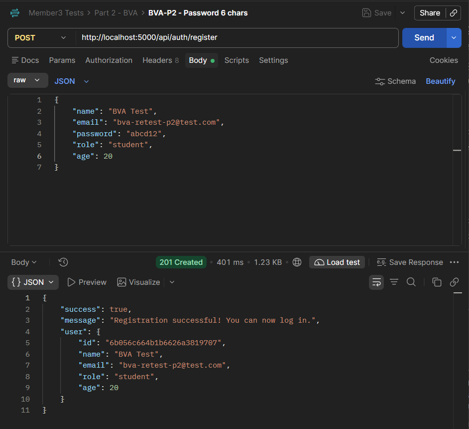
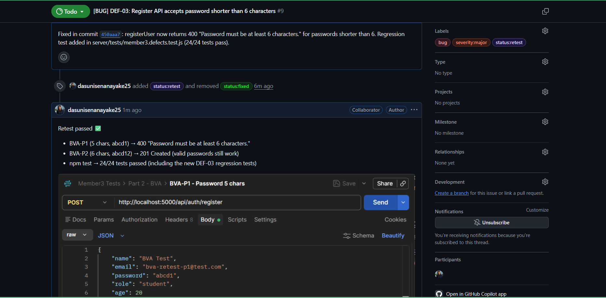