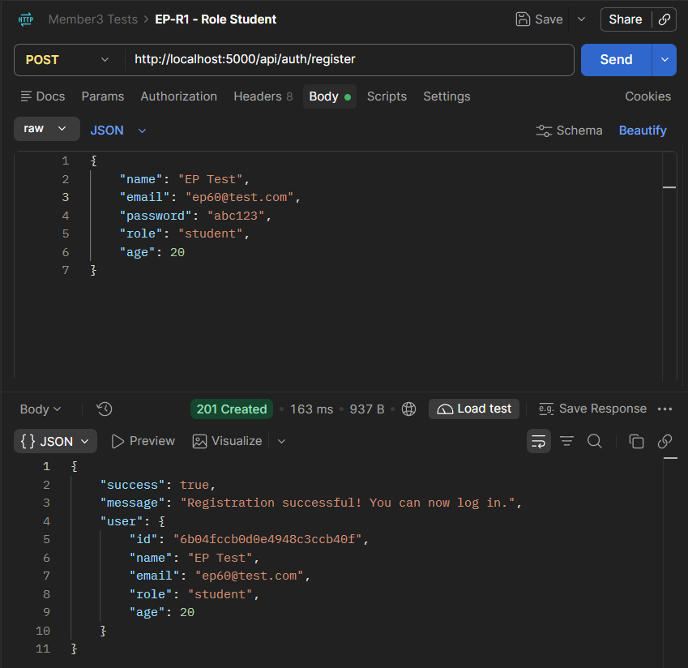
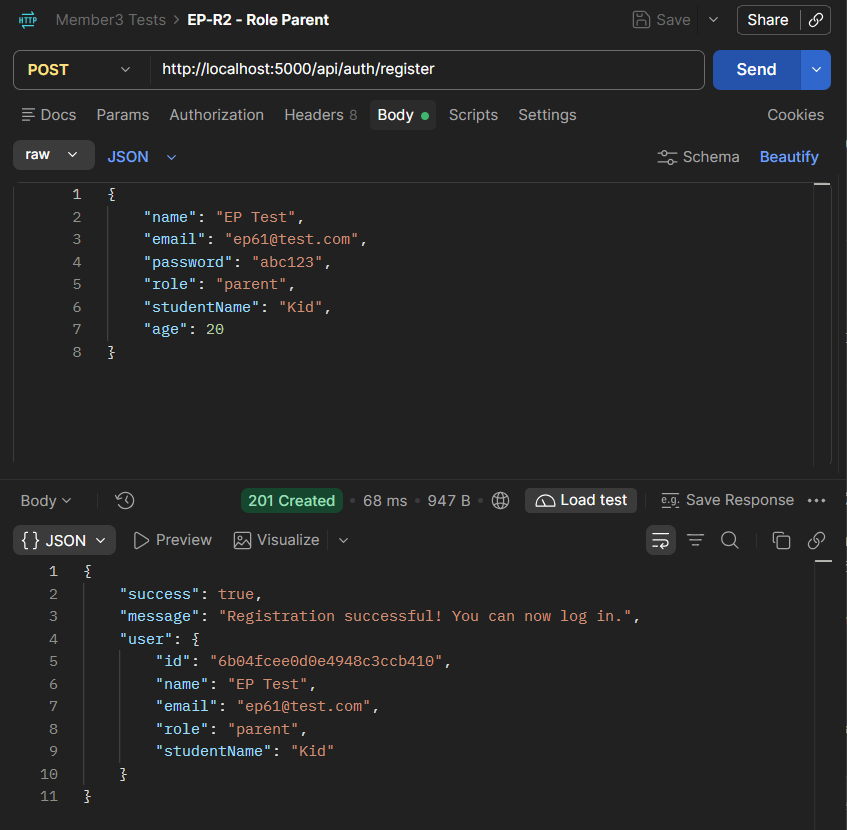

# Member 3 – Black-Box Testing & Defect Tracking

## Section 3.3: Black-Box Testing (LO-2)

### Test Environment
- OS: Windows 11, Browser: Chrome
- Backend: Node.js + Express on http://localhost:5000 (DB: cylixlab_test)
- Frontend: React + Vite on http://localhost:5173
- Tool: Postman
- Evidence:  

### 1. Equivalence Partitioning (EP)
Endpoint: `POST /api/auth/register`
Tool: Postman (Body → raw → JSON). Only one field is changed per test; all other fields stay valid.

#### Field 1: Email
| TC ID | Class | Input | Expected | Actual | Status |
|---|---|---|---|---|---|
| EP-E1 | Valid format | ep3@test.com | 201 Created | 201 Created – Registration successful | Pass |
| EP-E2 | Invalid – missing @ | eptst.com | 400 Bad Request | 201 Created – Registration successful | Fail |
| EP-E3 | Invalid – missing domain | usr@.com | 400 Bad Request | 201 Created – Registration successful | Fail |
| EP-E4 | Invalid – empty | "" | 400 Bad Request | 400 Bad Request – Email and password must be valid strings | Pass |
| EP-E5 | Invalid – not a string | 12345 | 400 Bad Request | 400 Bad Request – Email and password must be valid strings | Pass |

**EP-E1 – Valid email (Pass)**

**EP-E2 – Email without @ (Fail)**

**EP-E3 – Email without domain (Fail)**

**EP-E4 – Empty email (Pass)**

**EP-E5 – Numeric email (Pass)**

#### Field 2: Password
| TC ID | Class | Input | Expected | Actual | Status |
|---|---|---|---|---|---|
| EP-P1 | Valid – 6 or more chars | abc123 | 201 Created | 201 Created – Registration successful | Pass |
| EP-P2 | Invalid – too short (1–5 chars) | a1 | 400 Bad Request | 201 Created – Registration successful | Fail |
| EP-P3 | Invalid – empty | "" | 400 Bad Request | 400 Bad Request – Email and password must be valid strings | Pass |

**EP-P1 – Valid password (Pass)**

**EP-P2 – Short password (Fail)**

**EP-P3 – Empty password (Pass)**

#### Field 3: Role
| TC ID | Class | Input | Expected | Actual | Status |
|---|---|---|---|---|---|
| EP-R1 | Valid – student | student | 201 Created, role = student | 201 Created – role "student" | Pass |
| EP-R2 | Valid – parent | parent | 201 Created, role = parent | 201 Created – role "parent" | Pass |
| EP-R3 | Invalid – not allowed | admin | Must not create an admin account | 201 Created – role saved as "student" (admin rejected) | Pass |
| EP-R4 | Invalid – unknown | hacker | Must not accept role "hacker" | 201 Created – role saved as "student" (hacker rejected) | Pass |

**EP-R1 – Student role (Pass)**

**EP-R2 – Parent role (Pass)**

**EP-R3 – Admin role rejected (Pass)**

**EP-R4 – Unknown role rejected (Pass)**

#### EP Summary
| Field | Test Cases | Pass | Fail |
|---|---|---|---|
| Email | 5 | 3 | 2 |
| Password | 3 | 2 | 1 |
| Role | 4 | 4 | 0 |
| **Total** | **12** | **9** | **3** |

**Defects found by EP:**
- **DEF-01:** Register API accepts an email without "@" (EP-E2). No server-side email format validation.
- **DEF-02:** Register API accepts an email without a domain (EP-E3). Same root cause as DEF-01.
- **DEF-03:** Register API accepts a password shorter than 6 characters (EP-P2). The minimum length check exists only in the frontend (`Register.jsx`), not in the backend (`authController.js`).

**Observation:** The role field is handled correctly. Any role other than `student` or `parent` is replaced with `student`, so a user cannot register as `admin`.