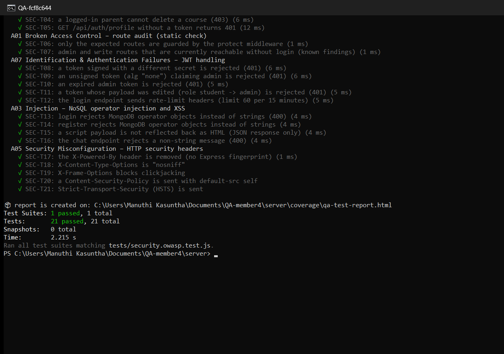
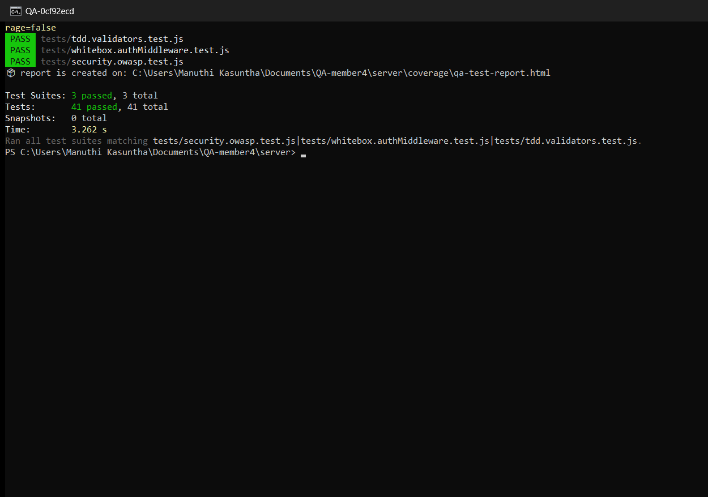
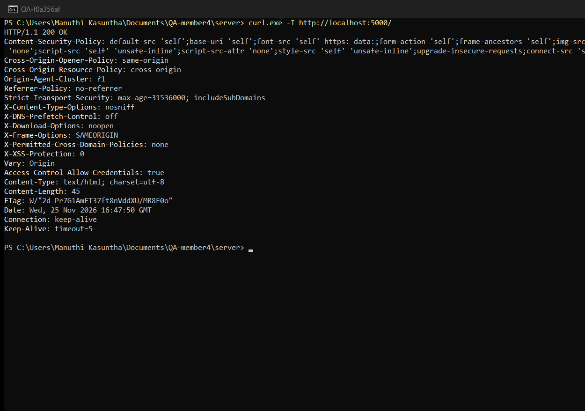
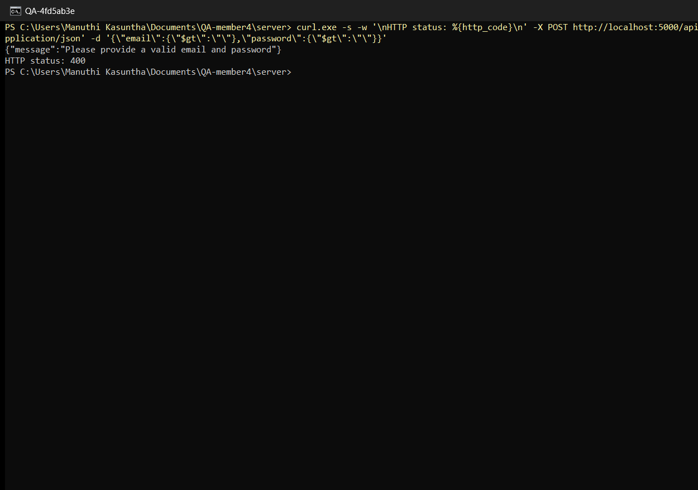
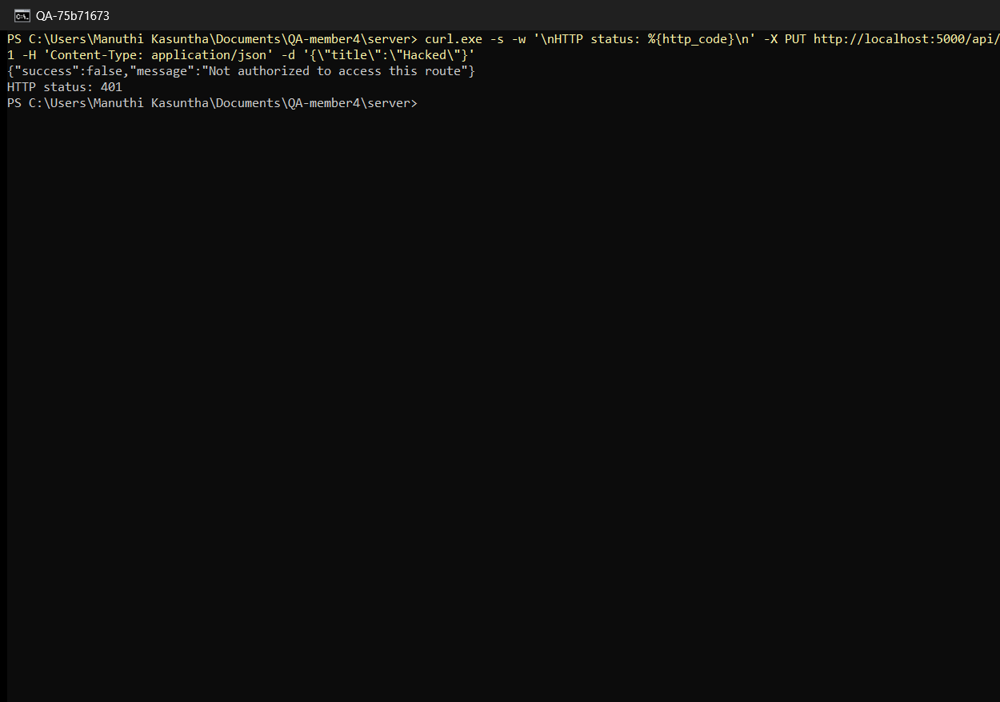
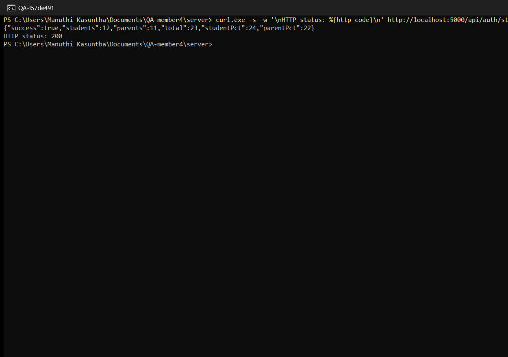
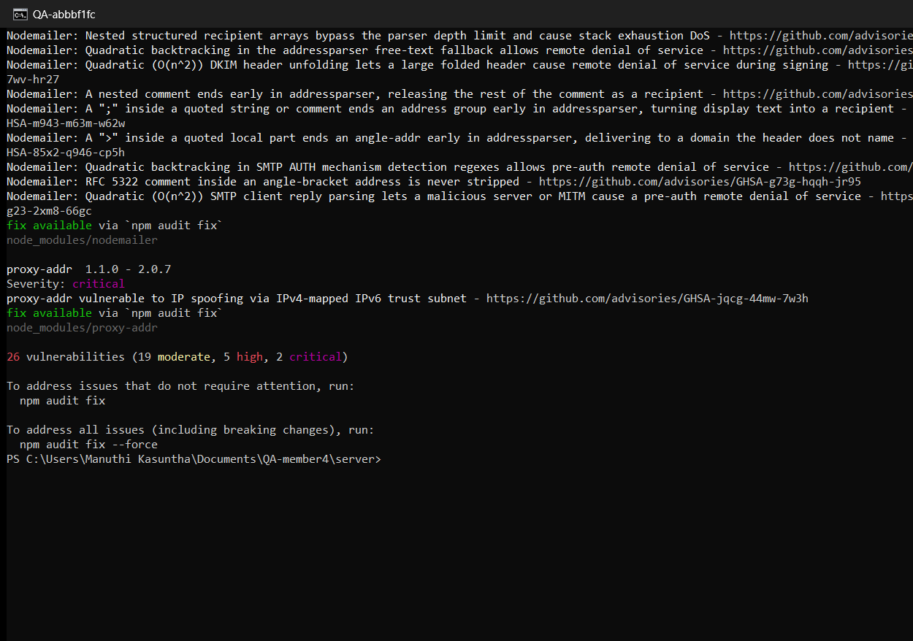
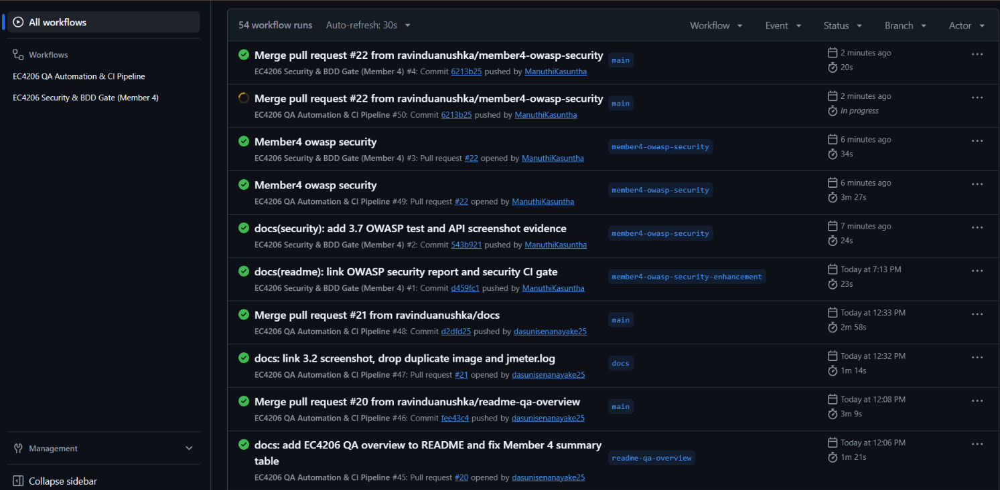
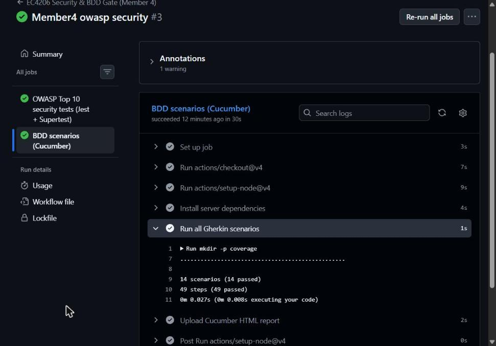
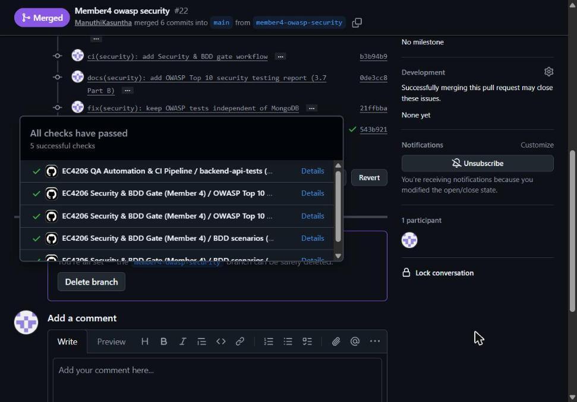

# Member 4 – Section 3.7 (Part B): OWASP Top 10 Security Testing

**Module:** EC4206 – Software Testing and Quality Assurance
**System under test:** CylixLab backend (`server/`), Express 5 + MongoDB
**Branch:** `member4-owasp-security-enhancement`
**Related:** Part A of Section 3.7 (JMeter load test) is in [member4-whitebox-bdd-perf.md](member4-whitebox-bdd-perf.md).

---

## 1. Objective and Scope

Section 3.7 asks for a manual inspection of 1–2 OWASP Top 10 risks. This part goes further. It checks **five OWASP Top 10 (2021) categories** and turns each check into an **automated, repeatable test** that runs in CI on every push and pull request.

| OWASP 2021 category | What was checked | How |
| :--- | :--- | :--- |
| **A01** Broken Access Control | Login and role checks on course routes; audit of every route for the `protect` middleware | Jest + Supertest, route audit, Cucumber |
| **A03** Injection | NoSQL operator injection on login/register/chat; reflected XSS | Jest + Supertest |
| **A05** Security Misconfiguration | Helmet security headers, CORS and CSP settings, error messages | Jest + Supertest, code review |
| **A06** Vulnerable & Outdated Components | Known CVEs in npm dependencies | `npm audit` in CI |
| **A07** Identification & Authentication Failures | Forged, unsigned, expired and edited JWTs; login rate limiting | Jest + Supertest, Cucumber |

**Out of scope:** the frontend, Google OAuth, the AI chat providers, and active attacks on the live deployment. All tests run against a local instance and need no database.

---

## 2. Test Environment

| Item | Value |
| :--- | :--- |
| Runtime | Node.js 22 (CI), Express 5.2, Helmet 8, express-rate-limit 8, jsonwebtoken 9 |
| Tools | Jest 30, Supertest 7, @cucumber/cucumber 13, npm audit |
| Database | Not needed: every request is answered before a MongoDB query runs |
| CI | `.github/workflows/security-qa.yml` (separate from `ci-qa.yml`) |

---

## 3. Automated Security Test Cases (Jest + Supertest)

File: [`server/tests/security.owasp.test.js`](../server/tests/security.owasp.test.js), with **21 tests, all passing**.

| ID | OWASP | Test | Expected | Actual | Status |
| :--- | :--- | :--- | :--- | :--- | :--- |
| SEC-T01 | A01 | `PUT /api/courses/:id` with no token | 401 | 401 | Pass |
| SEC-T02 | A01 | `DELETE /api/courses/:id` with no token | 401 | 401 | Pass |
| SEC-T03 | A01 | Student token updates a course (privilege escalation) | 403 | 403 | Pass |
| SEC-T04 | A01 | Parent token deletes a course | 403 | 403 | Pass |
| SEC-T05 | A01 | `GET /api/auth/profile` with no token | 401 | 401 | Pass |
| SEC-T06 | A01 | Route audit: which routes have `protect` | Only PUT/DELETE course and GET profile | Same | Pass |
| SEC-T07 | A01 | Route audit: admin/write routes without login | Records findings SEC-01 to SEC-04 | Confirmed | Pass (finding) |
| SEC-T08 | A07 | JWT signed with an attacker's secret | 401 | 401 | Pass |
| SEC-T09 | A07 | Unsigned JWT (`alg: none`) claiming `admin` | 401 | 401 | Pass |
| SEC-T10 | A07 | Expired admin JWT | 401 | 401 | Pass |
| SEC-T11 | A07 | JWT payload edited from `student` to `admin` | 401 | 401 | Pass |
| SEC-T12 | A07 | Rate-limit headers on `POST /api/auth/login` | `RateLimit-Limit: 60` | 60 | Pass |
| SEC-T13 | A03 | Login with `{"$gt": ""}` as email and password | 400, no token | 400 | Pass |
| SEC-T14 | A03 | Register with `{"$ne": null}` as email and password | Not 201 | 400 / 503 | Pass |
| SEC-T15 | A03 | `<script>` payload sent to login | JSON reply, payload not echoed | JSON, not echoed | Pass |
| SEC-T16 | A03 | Chat message sent as an object (`$where`) | 400 | 400 | Pass |
| SEC-T17 | A05 | `X-Powered-By` header | Absent | Absent | Pass |
| SEC-T18 | A05 | `X-Content-Type-Options` | `nosniff` | `nosniff` | Pass |
| SEC-T19 | A05 | `X-Frame-Options` (clickjacking) | `SAMEORIGIN` | `SAMEORIGIN` | Pass |
| SEC-T20 | A05 | `Content-Security-Policy` | `default-src 'self'` | Present | Pass |
| SEC-T21 | A05 | `Strict-Transport-Security` | `max-age` set | Present | Pass |

**How the route audit works (SEC-T06/T07):** the test reads the Express router stack of `authRoutes` and `courseRoutes` and checks whether the `protect` middleware is in each route's handler chain. This finds missing access control without a running database. If a developer later adds `protect` to one of the listed routes, SEC-T07 fails on purpose. That tells the team to update the list and close the finding, so the test works as a regression guard.

---

## 4. BDD Security Scenarios (Gherkin + Cucumber)

File: [`server/features/security_access_control.feature`](../server/features/security_access_control.feature), steps in [`security.steps.js`](../server/features/step_definitions/security.steps.js).

The scenarios run the real `protect()` and `authorize('instructor', 'admin')` middlewares, the same chain used by `PUT /api/courses/:id`.

```gherkin
Scenario Outline: Access to a protected course route depends on the token
  Given a visitor sends a course update request with a "<token>" token
  When the access control middleware checks the request
  Then the request is answered with status <status>
  And the course update handler is "<handler>"
```

| Token | Expected status | Handler reached | Result |
| :--- | :--- | :--- | :--- |
| missing | 401 | No | Pass |
| forged | 401 | No | Pass |
| expired | 401 | No | Pass |
| student | 403 | No | Pass |
| parent | 403 | No | Pass |
| admin | 200 | Yes | Pass |
| student edits token to claim `admin` | 401 | No | Pass |

This adds **7 scenarios (28 steps)** to the existing 7 registration scenarios.

---

## 5. Security Findings

The automated tests and a manual code review found the following issues. Severity uses the same scale as Section 3.8.

| ID | OWASP | Severity | Finding | Evidence |
| :--- | :--- | :--- | :--- | :--- |
| **SEC-01** | A01 | Major | `GET /api/auth/stats` returns admin user statistics (student/parent counts) to anyone, with no login. | `authRoutes.js`: no `protect`; SEC-T07 |
| **SEC-02** | A01 | Critical | `POST /api/courses` creates a course with no login. Same issue as **DEF-05** (Member 3). | `courseRoutes.js`; SEC-T07 |
| **SEC-03** | A01 | Critical | `POST /api/courses/learning-path-pdf` and `POST /api/courses/assignment-pdf` let anyone upload or replace curriculum PDFs. Only the frontend hides the admin page, so the server has no check. | `courseRoutes.js`; SEC-T07 |
| **SEC-04** | A01 | Critical | `GET /api/courses/admin-assignment-stats` returns every student's assignment marks with no login. | `courseRoutes.js`; SEC-T07 |
| **SEC-05** | A05 | Major | CORS allows **any** `*.vercel.app` origin with `credentials: true`, and allows every origin when `NODE_ENV` is not `production`. Anyone can host a site on Vercel. | `server.js` CORS callback |
| **SEC-06** | A05 | Minor | The CSP allows `'unsafe-inline'` scripts and `connect-src *`, which weakens XSS protection. | `server.js` Helmet config |
| **SEC-07** | A05 | Minor | 500/503 responses return `error.message` to the client (18 places in the controllers). This can leak database and internal details. | `controllers/*.js` |
| **SEC-08** | A05 | Minor | The JSON body limit is 50 MB on every route, which allows large-payload denial of service. It is only needed for base64 PDF uploads. | `server.js` `express.json({ limit: '50mb' })` |
| **SEC-09** | A06 | Critical | `npm audit` reports **26 vulnerable packages: 2 critical, 5 high, 19 moderate**. Critical: `mongoose` (direct) and `proxy-addr`. High: `nodemailer`, `cloudinary`, `multer-storage-cloudinary`, `body-parser`, `brace-expansion`. | `npm audit`; CI artifact `npm-audit-report` |
| **SEC-10** | A07 | Minor | JWTs are valid for 7 days and cannot be revoked (no logout blacklist or refresh token). | `authController.js` `expiresIn: '7d'` |

### What is already secure (positive results)

- **JWT validation is strong:** forged, unsigned (`alg: none`), expired and edited tokens are all rejected (SEC-T08 to T11).
- **Role checks work** where they are applied: students and parents get 403 on course update and delete (SEC-T03/T04).
- **NoSQL operator injection is blocked** on login, register and chat, because inputs are type-checked as strings and queries use `$eq` (SEC-T13 to T16).
- **DEF-06 retest:** `getStudentSubmissions` now escapes user input with `escapeRegex()`. The `.*` regex-injection problem logged by Member 3 is no longer in the code.
- **Helmet headers are in place**, `X-Powered-By` is removed, and login/register are rate-limited to 60 requests per 15 minutes (SEC-T12, T17 to T21).

---

## 6. Recommendations

| Finding | Recommended fix |
| :--- | :--- |
| SEC-01 to SEC-04 | Add `protect, authorize('admin')` to the stats, create-course, PDF upload and admin-stats routes. Then remove those routes from the list in SEC-T07. |
| SEC-05 | Replace `origin.endsWith('.vercel.app')` with the exact production URL from `CLIENT_URL`. Allow every origin only when `NODE_ENV === 'development'`. |
| SEC-06 | Remove `'unsafe-inline'` from `scriptSrc` and limit `connectSrc` to the API and AI provider domains. |
| SEC-07 | Log `error.message` on the server and return only a generic message such as `"Server Error"` to the client. |
| SEC-08 | Use a small global limit (e.g. `1mb`) and apply `50mb` only on the two PDF upload routes. |
| SEC-09 | Run `npm audit fix`, upgrade `mongoose`, `nodemailer` and `cloudinary`, then re-run the test suites. Change the CI step from `|| true` to a failing gate once the critical issues are fixed. |
| SEC-10 | Shorten the token lifetime (e.g. 1 hour) and add refresh tokens or a logout blacklist. |

These findings are recommendations for the team. This branch does **not** change application code, so no other member's work is affected.

---

## 7. CI Security Gate

A new workflow, [`.github/workflows/security-qa.yml`](../.github/workflows/security-qa.yml), runs on pushes to `main` and `member4-*` branches and on every pull request to `main`. It has two jobs:

1. **OWASP security tests**: runs `security.owasp.test.js`, then `npm audit`, and uploads `npm-audit-report.json` as an artifact.
2. **BDD (Cucumber)**: runs **all** Gherkin scenarios (registration + security) and uploads `cucumber-report.html`.

It needs no database or secrets, so it runs on any branch. The existing `ci-qa.yml` pipeline is unchanged. Before this workflow, the Cucumber scenarios were not run in CI.

---

## 8. How to Run

```bash
cd server
npm install

# OWASP security tests (no database needed)
npx jest tests/security.owasp.test.js

# All BDD scenarios, including the new security scenarios (Node 22 / 24 / 26+)
npm run bdd -- --format progress --format html:coverage/cucumber-report.html

# Dependency vulnerability report
npm audit
```

---

## 9. Test Evidence (Screenshots)

* `report-screenshots/3.7_OWASP_Jest_Security_Tests_21_Pass.png`: all 21 OWASP security tests passing (A01, A03, A05, A07)  


* `report-screenshots/3.7_OWASP_Combined_Suites_41_Pass.png`: the security, white-box and TDD suites run together (41 tests), showing the new tests do not affect existing ones  


* `report-screenshots/3.7_OWASP_A05_Security_Headers.png`: Helmet security headers returned by `GET /` (CSP, HSTS, `nosniff`, `X-Frame-Options`, no `X-Powered-By`)  


* `report-screenshots/3.7_OWASP_A03_NoSQL_Injection_Blocked.png`: login with `{"$gt": ""}` operator objects is rejected with 400 and no token  


* `report-screenshots/3.7_OWASP_A01_Update_Without_Token_401.png`: `PUT /api/courses/:id` without a token is rejected with 401  


* `report-screenshots/3.7_OWASP_A01_SEC01_Admin_Stats_No_Login.png`: finding SEC-01, admin statistics returned with no login  


* `report-screenshots/3.7_OWASP_A06_npm_Audit_Summary.png`: finding SEC-09, `npm audit` summary (26 vulnerabilities: 2 critical, 5 high, 19 moderate)  


* `report-screenshots/3.7_Security_CI_Gate_Pass.png`: the `security-qa.yml` workflow passing on GitHub Actions (both jobs green)  


* `report-screenshots/3.7_BDD_Security_Cucumber_Pass.png`: Cucumber run in CI with all 14 scenarios passing (7 registration + 7 security)  


* `report-screenshots/3.7_Security_PR_Checks_Pass.png`: the Pull Request to `main` with all checks passing before merge  


---

## 10. Summary

| Deliverable | Result |
| :--- | :--- |
| OWASP Top 10 categories covered | 5 (A01, A03, A05, A06, A07) |
| Automated security tests (Jest + Supertest) | 21 / 21 passing |
| BDD security scenarios (Cucumber) | 7 scenarios, all passing |
| Security findings | 10 (SEC-01 to SEC-10): 4 Critical, 2 Major, 4 Minor |
| CI | New `security-qa.yml` gate: security tests, npm audit, all Cucumber scenarios |
