# Member 4 – White-Box Testing, BDD, Performance Testing & Case Study

**Course:** EC4206 – Software Testing and Quality Assurance  
**Department:** Department of Electrical and Information Engineering, University of Ruhuna  
**Role:** Member 4  
**Assigned Sections:** Section 3.4 (White-Box Testing), Section 3.5 (TDD/BDD), Section 3.7 (Performance & Load Testing - Apache JMeter), Section 3.10 (Case Study & Reflection)  
**Workload Allocation:** 25%  
**Assigned Git Branch:** `member4-whitebox-bdd-perf`  
**Isolated QA Repository:** [https://github.com/ravinduanushka/QA-project-.git](https://github.com/ravinduanushka/QA-project-.git)  

---
## Section 3.4: White-Box Testing (LO-2)

### 1. Function Under Test
**`protect()`** in `server/src/middlewares/authMiddleware.js` (lines 4–25) is the authentication middleware that guards every protected route. It was chosen because it is security-critical, contains three decision points, and can be unit-tested in isolation without a database.

```js
exports.protect = async (req, res, next) => {
  let token;                                              // N1
  if (req.headers.authorization &&                        // N2 (decision 1)
      req.headers.authorization.startsWith('Bearer')) {
    token = req.headers.authorization.split(' ')[1];      // N3
  }
  if (!token) {                                           // N4 (decision 2)
    return res.status(401).json({ ... });                 // N5
  }
  try {
    const decoded = jwt.verify(token, process.env.JWT_SECRET); // N6 (decision 3: throws?)
    req.user = decoded;                                   // N7
    next();
  } catch (error) {
    return res.status(401).json({ ... });                 // N8
  }
};                                                        // N9 (exit)
```

### 2. Control Flow Graph (CFG)
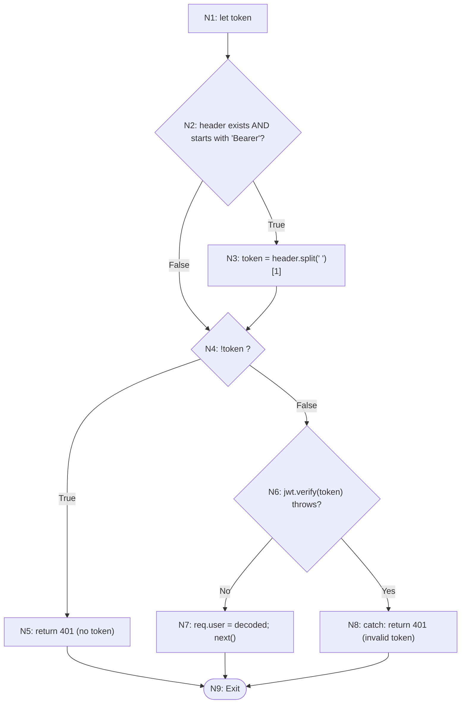
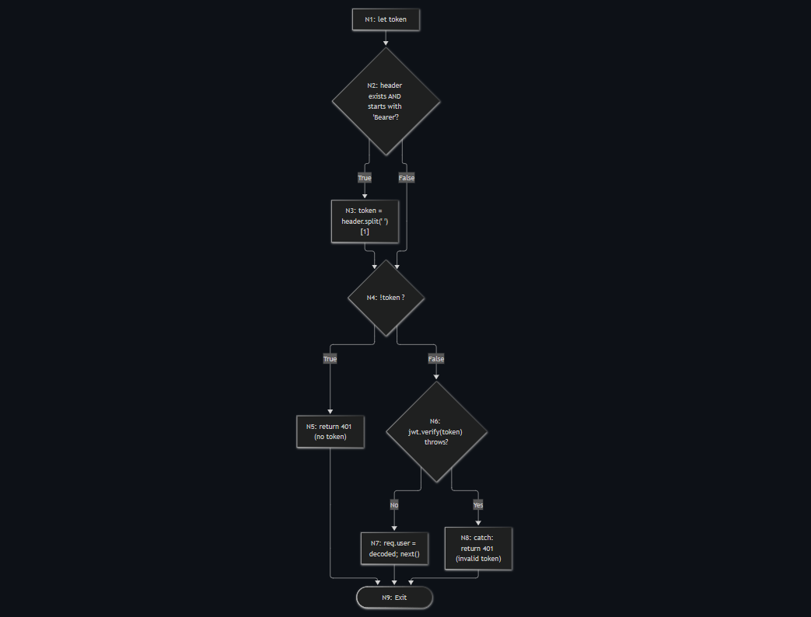

### 3. Cyclomatic Complexity
- Nodes **N = 9**, Edges **E = 11** (N1→N2, N2→N3, N2→N4, N3→N4, N4→N5, N4→N6, N6→N7, N6→N8, N5→N9, N7→N9, N8→N9), connected components **P = 1**
- **V(G) = E − N + 2P = 11 − 9 + 2 = 4**
- Check with predicate nodes: **V(G) = P + 1 = 3 + 1 = 4** (decisions N2, N4, N6)
- Risk level: **1–10 = Low** – simple and easy to test.
- `authorize()` (lines 28–38) has one decision, so **V(G) = 2**.

**Basis paths (4):**
| Path | Nodes | Meaning |
|---|---|---|
| P1 | N1 → N2 → N4 → N5 → N9 | No header / not a Bearer header |
| P2 | N1 → N2 → N3 → N4 → N5 → N9 | "Bearer" with an empty token |
| P3 | N1 → N2 → N3 → N4 → N6 → N8 → N9 | Token present but invalid |
| P4 | N1 → N2 → N3 → N4 → N6 → N7 → N9 | Valid token, access granted |

### 4. Test Cases for 100% Statement and Branch Coverage
Tool: Jest with mocked `req`, `res` and `next` (`server/tests/whitebox.authMiddleware.test.js`).

| TC ID | Input (Authorization header / role) | Path | N2 | N4 | N6 | Expected | Actual | Status |
|---|---|---|---|---|---|---|---|---|
| WB-01 | *(none)* | P1 | F (A=F) | T | – | 401, next() not called | 401 | Pass |
| WB-02 | `Basic abc123` | P1 | F (A=T, B=F) | T | – | 401 | 401 | Pass |
| WB-03 | `Bearer` | P2 | T | T | – | 401 | 401 | Pass |
| WB-04 | `Bearer invalid.token.value` | P3 | T | F | Throws | 401 | 401 | Pass |
| WB-05 | `Bearer <valid JWT>` | P4 | T | F | No throw | next() called, req.user set | next() called, role = student | Pass |
| WB-06 | authorize('instructor','admin'), role = admin | – | – | – | – | next() called | next() called | Pass |
| WB-07 | authorize('instructor','admin'), role = student | – | – | – | – | 403 | 403 | Pass |

- **Statement coverage:** every statement N1–N9 is executed by WB-01…WB-05.
- **Branch coverage:** N2, N4 and N6 each take both their True and False outcomes.
- **Condition coverage (bonus):** WB-01 and WB-02 make each part of the compound condition `A && B` false on its own.
- The 4 basis paths match **V(G) = 4**, which is the minimum number of tests needed for path coverage of `protect()`.

### 5. Coverage Result
| File | % Stmts | % Branch | % Funcs | % Lines |
|---|---|---|---|---|
| authMiddleware.js | 100 | 100 | 100 | 100 |

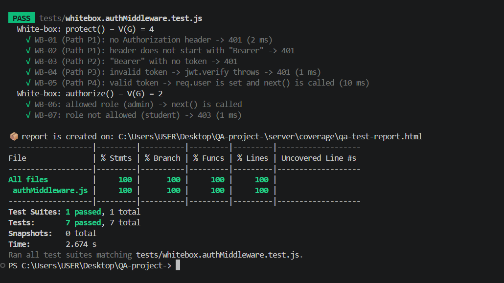

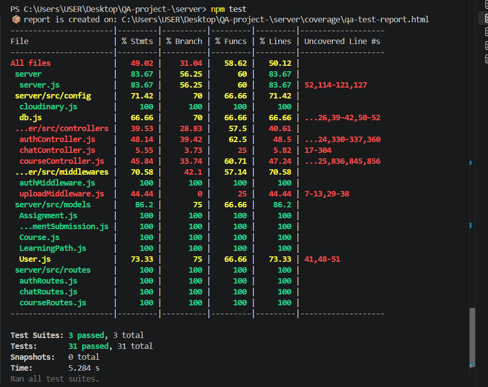


---

## Section 3.5: TDD / BDD (LO-2, LO-3)

### 1. Test-Driven Development (Jest)
**Unit under development:** `server/src/utils/validators.js` – `validateEmail()`, `validatePassword()`, `validateAge()`.
**Test file:** `server/tests/tdd.validators.test.js` (13 unit tests).
The test values are taken from the Section 3.3 EP/BVA test cases, so these validators directly address defects DEF-01, DEF-02, DEF-03 and DEF-04.

**Red → Green → Refactor cycle**
| Step | What was done | Result |
|---|---|---|
| 1. RED | All 13 tests written first, before any validator was implemented | All 13 tests fail – `validateX is not a function` |
| 2. GREEN (password) | Minimum code: `validatePassword()` only | 4 password tests pass, 9 email/age tests still fail |
| 3. GREEN (all) | Added `validateEmail()` and `validateAge()` with minimum logic | 13 / 13 pass |
| 4. REFACTOR | Removed the repeated `{ valid: false, message }` objects with `ok()` / `fail()` helpers, and replaced magic numbers with named constants | 13 / 13 still pass – behaviour unchanged |

**Unit test cases**
| TC ID | Function | Input | Expected | Source |
|---|---|---|---|---|
| TDD-P1 | validatePassword | `""` | invalid | EP-P3 |
| TDD-P2 | validatePassword | `abcd1` (5) | invalid | BVA-P1 / DEF-03 |
| TDD-P3 | validatePassword | `abcd12` (6) | valid | BVA-P2 |
| TDD-P4 | validatePassword | `12345` (number) | invalid | EP |
| TDD-E1 | validateEmail | `student@test.com` | valid | EP-E1 |
| TDD-E2 | validateEmail | `eptst.com` | invalid | EP-E2 / DEF-01 |
| TDD-E3 | validateEmail | `usr@.com` | invalid | EP-E3 / DEF-02 |
| TDD-E4 | validateEmail | `""` | invalid | EP-E4 |
| TDD-A1 | validateAge | `3` | invalid | BVA-A1 / DEF-04 |
| TDD-A2 | validateAge | `4` | valid | BVA-A2 |
| TDD-A3 | validateAge | `120` | valid | BVA-A5 |
| TDD-A4 | validateAge | `121` | invalid | BVA-A6 / DEF-04 |
| TDD-A5 | validateAge | `"abc"` | invalid | EP |

**Step 1 – RED**
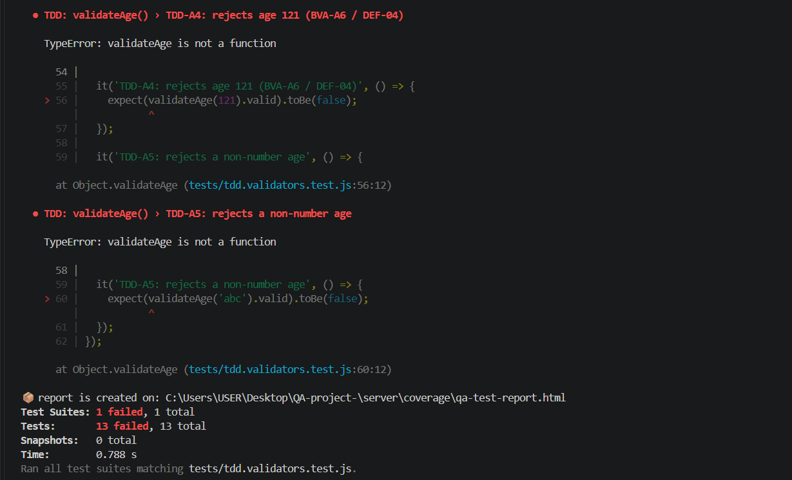

**Step 2 – GREEN (password only)**
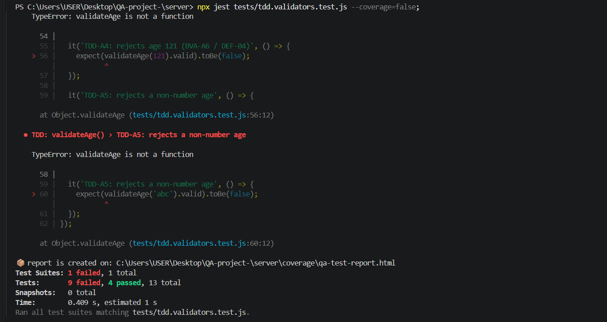

**Step 3 – GREEN (all)**
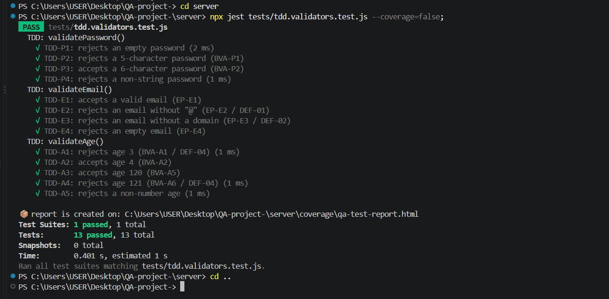

**Step 4 – REFACTOR (still green)**
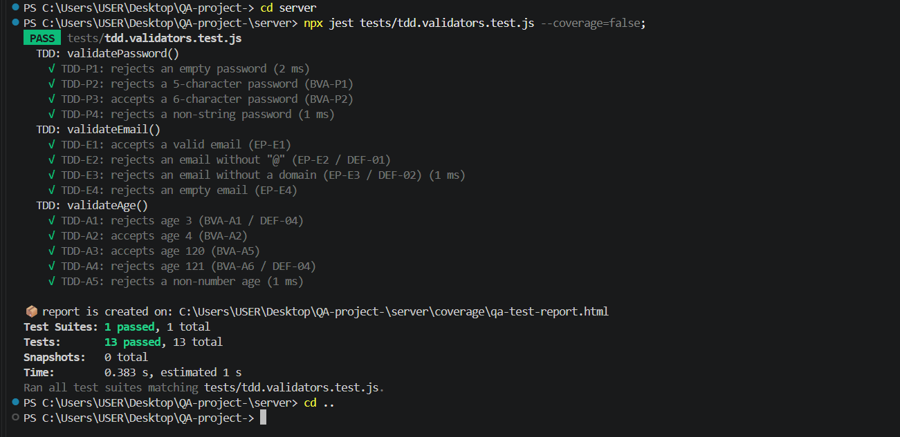

### 2. Behaviour-Driven Development (Cucumber)
**Tool:** `@cucumber/cucumber` – run with `npm run bdd` inside `server/`.
**Files:** `server/features/registration_validation.feature` (Gherkin) and `server/features/step_definitions/registration.steps.js` (step definitions).

```gherkin
Feature: Student registration input validation
  As a CylixLab student
  I want my registration details to be checked
  So that only accounts with valid details are created

  Scenario Outline: Password must have at least 6 characters
    Given a student enters the password "<password>"
    When the registration details are validated
    Then the password should be "<result>"

    Examples:
      | password | result   |
      | abcd1    | rejected |
      | abcd12   | accepted |
      | abcd123  | accepted |

  Scenario Outline: Student age must be between 4 and 120
    Given a student enters the age <age>
    When the registration details are validated
    Then the age should be "<result>"

    Examples:
      | age | result   |
      | 3   | rejected |
      | 4   | accepted |
      | 120 | accepted |
      | 121 | rejected |
```

- Step values are parameterised with `{string}` and `{int}`, so no values are hard-coded in the step definitions.
- The Cucumber World (`this`) shares data between the Given, When and Then steps of one scenario.
- **Result:** 7 scenarios (7 passed), 21 steps (21 passed).

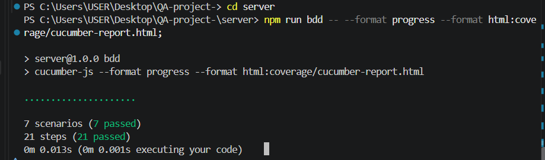

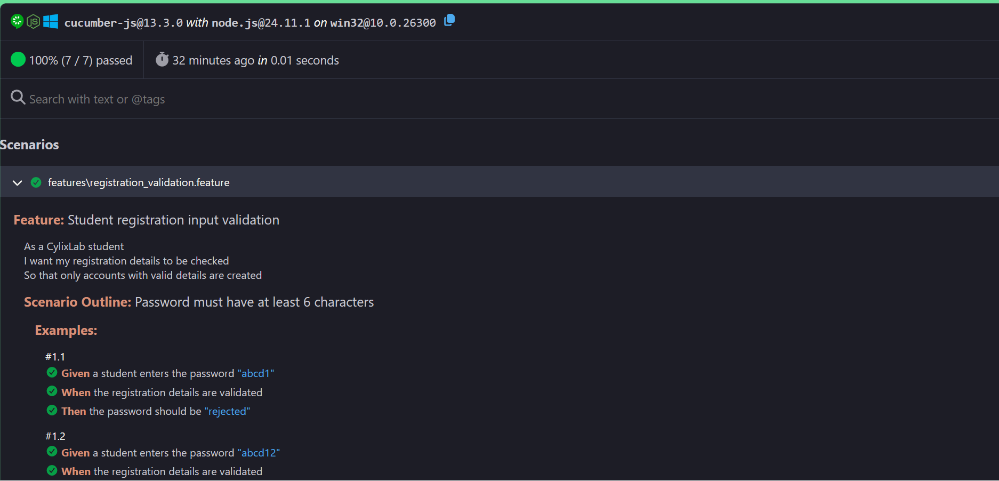

### 3. TDD vs. BDD in this project
| | TDD (Jest) | BDD (Cucumber) |
|---|---|---|
| Written in | JavaScript test code | Plain-language Gherkin |
| Audience | Developers | Developers, testers and product owners |
| Focus | Correctness of each function | Business rule: "only valid registration details are accepted" |
| Value here | Safe refactoring – tests stayed green after the refactor | Living documentation of the registration rules |

**Full suite after all changes:** all Jest tests pass (existing API tests + white-box + TDD).

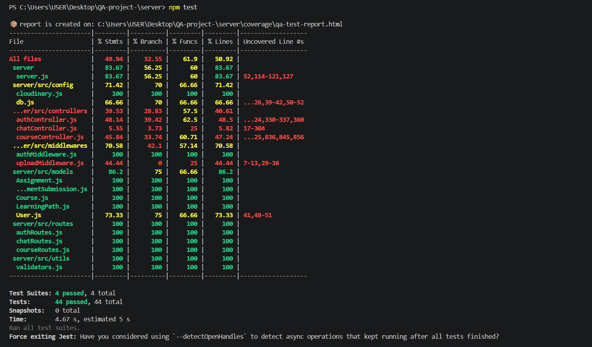

## Section 3.7: Performance and Load Testing (Apache JMeter)

### 3.7.1 Objective and Scope
Load testing was performed on the **CylixLab** backend API (`GET http://localhost:5000/api/courses`) using **Apache JMeter 5.6.3** on Windows to evaluate response latency, throughput, reliability, and error behavior under concurrent user load.

### 3.7.2 Test Configuration and Environment Setup
* **Target Endpoint:** `GET http://localhost:5000/api/courses`
* **Load Tool:** Apache JMeter 5.6.3 (Executed via CLI with HTML Dashboard generation and verified in GUI)
* **Workload Profile:**
  * **Number of Threads (Concurrent Users):** 50
  * **Ramp-Up Period:** 10 seconds
  * **Loop Count:** 5 loops per thread
  * **Total Samples:** 250 requests
* **Environment Notes:**
  * Resolved Java GUI Look and Feel compatibility (`java.lang.NoClassDefFoundError` in Darklaf) by switching to the `Metal` Look and Feel (`-Jjmeter.laf=javax.swing.plaf.metal.MetalLookAndFeel`).
  * Prevented listener file-deletion errors (`AbstractAction`) by keeping listener filename fields empty and generating reports cleanly from `.jtl` output via CLI (`-n -t ... -l ... -e -o ...`).

### 3.7.3 Performance Metrics Summary
| Metric | Measured Value | Interpretation |
| :--- | :--- | :--- |
| **Total Samples** | 250 | All 250 scheduled requests executed across 50 users × 5 loops |
| **APDEX Score** | 0.938 (T = 500 ms, F = 1500 ms) | Indicates high overall user satisfaction against latency thresholds |
| **Successful Requests (PASS)** | 236 (94.40%) | Majority of requests returned valid responses |
| **Failed Requests (FAIL)** | 14 (5.60%) | All 14 failures were `500/Internal Server Error` |
| **Average Response Time** | 152.49 ms | Fast average response under 50-user load |
| **Minimum Response Time** | 47 ms | Best-case response latency |
| **Median (50th Percentile)** | 127.00 ms | Half of all requests completed in 127 ms or less |
| **90th Percentile** | 189.00 ms | 90% of requests completed within 189 ms |
| **95th Percentile** | 268.50 ms | 95% of requests completed within 268.50 ms |
| **99th Percentile** | 930.65 ms | Tail latency spike observed during peak concurrency |
| **Maximum Response Time** | 1211 ms | Peak response time recorded during heavy concurrency |
| **Throughput** | 24.12 transactions/sec | Sustained request completion rate across the test run |
| **Network Throughput** | 43.58 KB/sec received, 2.90 KB/sec sent | Payload transfer rate during course retrieval |

### 3.7.4 Key Findings and Root Cause Analysis
1. **Strong Baseline Latency and Throughput:** With an **APDEX of 0.938**, **152.49 ms** average response time, **127.00 ms** median, and **24.12 req/s** throughput (with over 225 responses falling in the 100–200 ms distribution band), the `/api/courses` endpoint performs efficiently for normal and moderate traffic.
2. **HTTP 500 Errors Under Concurrent Load (5.60%):** Fourteen out of 250 requests (5.60%) failed with `500/Internal Server Error`, accompanied by a 99th percentile latency of **930.65 ms** and a maximum latency of **1211 ms**. Under simultaneous requests from 50 virtual users, transient server or database/connection handling bottlenecks caused unhandled exceptions or connection contention.

### 3.7.5 Recommendations
* **Inspect Backend Error Logs for `/api/courses`:** Review server logs around the test timestamp to identify the exact stack trace behind the 14 `HTTP 500` responses (e.g., database query/connection pooling limits, missing error handling, or async/await rejections).
* **Optimize Database Access and Caching:** Add appropriate database indexes, verify connection pool sizing, and consider caching frequently read course catalog data (`GET /api/courses`) to reduce tail latency (P95/P99) and prevent `500` errors under spikes.
* **Re-test After Fix:** Re-run the 50-user JMeter test after applying backend fixes to confirm a **0.00% error rate** and tighter P95/P99 response times.

### 3.7.6 Test Evidence (Screenshots)
* `report-screenshots/3.7_Backend_Server_Startup_Verification.png` — Backend server startup verification  


* `report-screenshots/3.7_JMeter_Dashboard_Overview_APDEX.png` — JMeter Dashboard overview, APDEX (0.938), and Requests Summary  


* `report-screenshots/3.7_JMeter_Statistics_and_Errors_Summary.png` — Statistics table and `500/Internal Server Error` summary (14 errors / 5.60%)  


* `report-screenshots/3.7_JMeter_Top_Errors_Breakdown.png` — Top errors breakdown by sampler (`GET Courses API`)  


* `report-screenshots/3.7_JMeter_Response_Time_Distribution.png` — Response time distribution histogram across all 250 samples  


* `report-screenshots/3.7_JMeter_Response_Times_Over_Time.png` — Response times over time chart  


---

## Section 3.10: Case Study & Best Practices Reflection (LO-1, LO-4)

### 3.10.1 Agile Testing Approach in CylixLab
In the CylixLab testing lifecycle, Agile testing methodologies were applied through an iterative, collaborative approach across all four team members:
* **Early Defect Detection (Shift-Left Testing):** Testing was not treated as a final phase. Instead, test planning (Member 2), black-box boundary analysis (Member 3), and white-box unit paths (Member 4) were formulated early in parallel with environment setup.
* **Continuous Feedback Loops:** When Member 3 identified password validation defects (DEF-03 / Issue #9), automated unit regression tests were developed, validated, and linked back to GitHub Issues to close the defect lifecycle efficiently.
* **Behavior-Driven Collaboration:** Formulating test scenarios ensured that acceptance criteria aligned with user expectations for authentication, course browsing, and dashboard features.

### 3.10.2 DevOps Implementation & Automated CI Quality Gates
The team utilized modern DevOps principles to guarantee system stability and release confidence:
* **Feature Branching Strategy:** Strict Git isolation was enforced. Each member worked exclusively inside designated feature branches (`member1-automation-cicd-sonar`, `member2-testplan-testcases`, `member3-blackbox-defects`, `member4-whitebox-bdd-perf`), merging into `main` solely via verified Pull Requests. This eliminated merge collisions and kept the production/test baseline pristine.
* **Continuous Integration (GitHub Actions):** Through `.github/workflows/ci-qa.yml`, every push and pull request automatically triggered isolated MongoDB test environments, executed backend test suites (Jest/Supertest), and prevented broken builds from reaching `main`.
* **Fast Failure & Traceability:** Automated build logs and test outputs provided immediate feedback on regressions, reducing mean time to detect (MTTD) bugs.

### 3.10.3 Continuous Static Analysis & Quality Governance (SonarQube)
* **Pre-Deployment Static Auditing:** Integrating SonarQube enabled continuous inspection of technical debt, maintainability ratings, code duplications, and security hotspots across both `server/` and `frontend/`.
* **Enforced Quality Gates:** Pull requests were subject to SonarQube quality criteria, motivating targeted refactoring (e.g., removing unused imports, fixing async/await rejections) before code integration.

### 3.10.4 Key Lessons Learned & Industry Recommendations
1. **Load Testing Uncovers Hidden Architectural Limits:** While unit and integration tests achieved 100% pass rates, JMeter load testing (Section 3.7) revealed a 5.60% HTTP 500 error rate under 50 concurrent users. This demonstrated that functional correctness does not guarantee performance resilience under concurrency.
2. **Database Pooling & Caching:** In production MERN architectures, database query optimization, Redis catalog caching (`GET /api/courses`), and robust connection pool limits must accompany automated CI gates.
3. **Comprehensive Automated Test Pyramid:** Combining unit tests (Jest), functional API tests (Supertest), load tests (JMeter), and static security scans creates a dependable defense-in-depth quality assurance model.

---

## Member 4 – Summary of Deliverables
| Task (from Assignment Specification) | Deliverable / Coverage | Status |
| **3.4 White-Box Testing** | CFG of `protect()` middleware, V(G) = 4, 4 basis paths, 7 Jest tests (WB-01..WB-07) | Completed |
| **3.4 Code Coverage** | `authMiddleware.js` at 100% statement, branch, function and line coverage | Completed |
| **3.5 TDD (Jest)** | `validators.js` built Red → Green → Refactor with 13 unit tests (TDD-P/E/A) | Completed |
| **3.5 BDD (Cucumber)** | `registration_validation.feature`: 7 scenarios, 21 steps passed, plus HTML report | Completed |
| :--- | :--- | :--- |
| **3.7 Performance & Load Testing** | 50 concurrent users, 10s ramp-up, 250 requests on `/api/courses` via Apache JMeter 5.6.3 | Completed |
| **3.7 APDEX & Latency Analysis** | APDEX 0.938, Avg 152.49 ms, Median 127.00 ms, 90th percentile 189.00 ms | Completed |
| **3.7 Error Identification & RCA** | Identified 14 `HTTP 500` server contention errors (5.60% error rate) with recommendations | Completed |
| **3.7 Test Evidence & Artifacts** | JMeter test script (`.jmx`), execution log (`results.jtl`), HTML dashboard report, and visual evidence screenshots | Completed |
| **3.10 Agile & DevOps Reflection** | Comprehensive evaluation of feature branching, automated CI gates, SonarQube quality gates, and shift-left testing | Completed |
