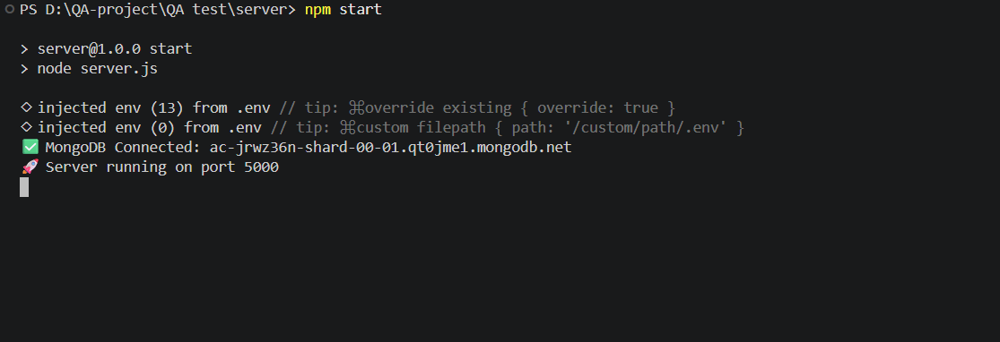
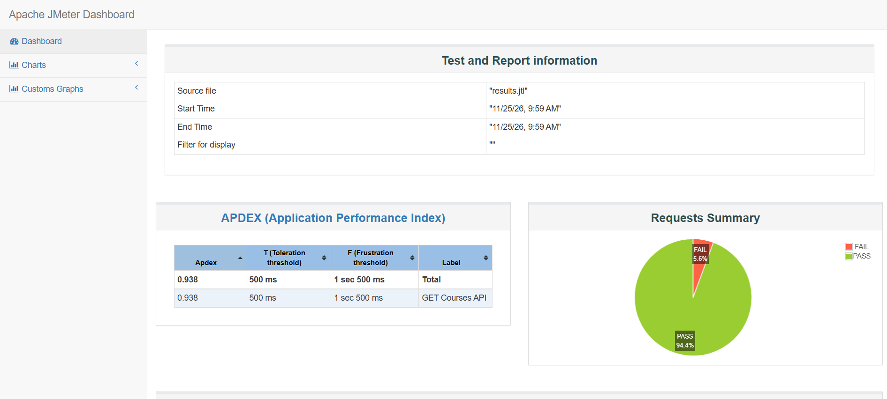
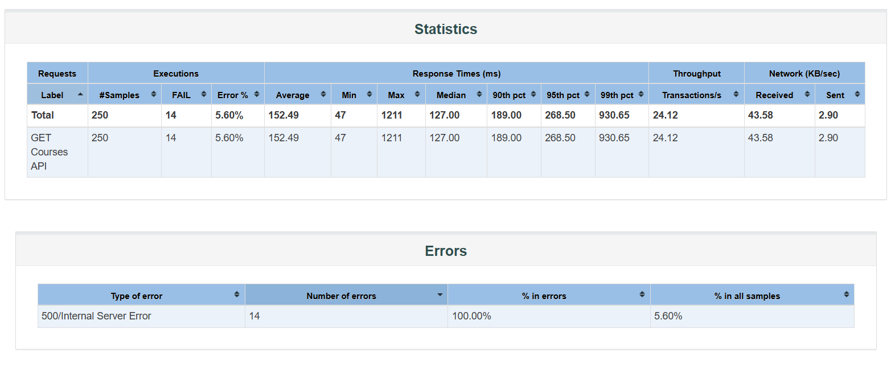
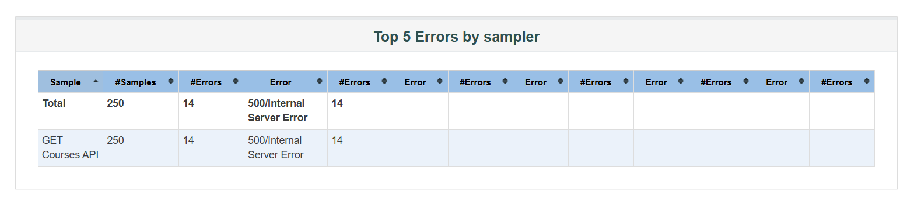
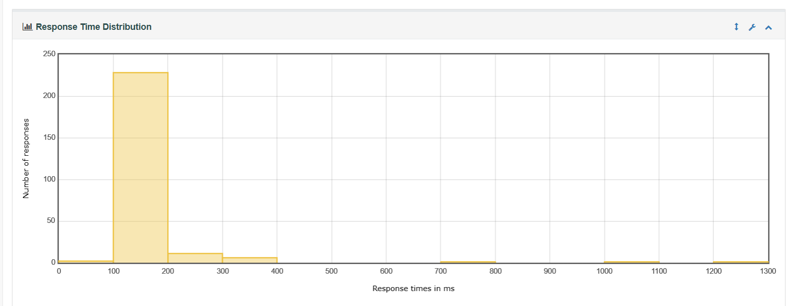
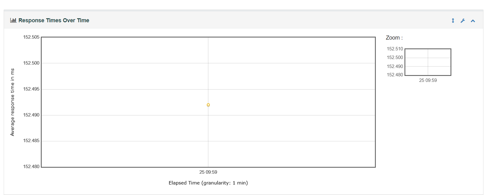

# Member 4 – White-Box Testing, BDD, Performance Testing & Case Study

**Course:** EC4206 – Software Testing and Quality Assurance  
**Department:** Department of Electrical and Information Engineering, University of Ruhuna  
**Role:** Member 4  
**Assigned Sections:** Section 3.4 (White-Box Testing), Section 3.5 (TDD/BDD), Section 3.7 (Performance & Load Testing - Apache JMeter), Section 3.10 (Case Study & Reflection)  
**Workload Allocation:** 25%  
**Assigned Git Branch:** `member4-whitebox-bdd-perf`  
**Isolated QA Repository:** [https://github.com/ravinduanushka/QA-project-.git](https://github.com/ravinduanushka/QA-project-.git)  

---

## Section 3.7: Performance and Load Testing (Apache JMeter)

### 3.7.1 Objective and Scope
Load testing was performed on the **CylixLab** backend API (`GET http://localhost:5000/api/courses`) using **Apache JMeter 5.6.3** on Windows to evaluate response latency, throughput, reliability, and error behavior under concurrent user load.

### 3.7.2 Test Configuration and Environment Setup
* **Target Endpoint:** `GET http://localhost:5000/api/courses`
* **Load Tool:** Apache JMeter 5.6.3 (Executed via CLI with HTML Dashboard generation and verified in GUI)
* **Workload Profile:**
  * **Number of Threads (Concurrent Users):** 50
  * **Ramp-Up Period:** 10 seconds
  * **Loop Count:** 5 loops per thread
  * **Total Samples:** 250 requests
* **Environment Notes:**
  * Resolved Java GUI Look and Feel compatibility (`java.lang.NoClassDefFoundError` in Darklaf) by switching to the `Metal` Look and Feel (`-Jjmeter.laf=javax.swing.plaf.metal.MetalLookAndFeel`).
  * Prevented listener file-deletion errors (`AbstractAction`) by keeping listener filename fields empty and generating reports cleanly from `.jtl` output via CLI (`-n -t ... -l ... -e -o ...`).

### 3.7.3 Performance Metrics Summary
| Metric | Measured Value | Interpretation |
| :--- | :--- | :--- |
| **Total Samples** | 250 | All 250 scheduled requests executed across 50 users × 5 loops |
| **APDEX Score** | 0.938 (T = 500 ms, F = 1500 ms) | Indicates high overall user satisfaction against latency thresholds |
| **Successful Requests (PASS)** | 236 (94.40%) | Majority of requests returned valid responses |
| **Failed Requests (FAIL)** | 14 (5.60%) | All 14 failures were `500/Internal Server Error` |
| **Average Response Time** | 152.49 ms | Fast average response under 50-user load |
| **Minimum Response Time** | 47 ms | Best-case response latency |
| **Median (50th Percentile)** | 127.00 ms | Half of all requests completed in 127 ms or less |
| **90th Percentile** | 189.00 ms | 90% of requests completed within 189 ms |
| **95th Percentile** | 268.50 ms | 95% of requests completed within 268.50 ms |
| **99th Percentile** | 930.65 ms | Tail latency spike observed during peak concurrency |
| **Maximum Response Time** | 1211 ms | Peak response time recorded during heavy concurrency |
| **Throughput** | 24.12 transactions/sec | Sustained request completion rate across the test run |
| **Network Throughput** | 43.58 KB/sec received, 2.90 KB/sec sent | Payload transfer rate during course retrieval |

### 3.7.4 Key Findings and Root Cause Analysis
1. **Strong Baseline Latency and Throughput:** With an **APDEX of 0.938**, **152.49 ms** average response time, **127.00 ms** median, and **24.12 req/s** throughput (with over 225 responses falling in the 100–200 ms distribution band), the `/api/courses` endpoint performs efficiently for normal and moderate traffic.
2. **HTTP 500 Errors Under Concurrent Load (5.60%):** Fourteen out of 250 requests (5.60%) failed with `500/Internal Server Error`, accompanied by a 99th percentile latency of **930.65 ms** and a maximum latency of **1211 ms**. Under simultaneous requests from 50 virtual users, transient server or database/connection handling bottlenecks caused unhandled exceptions or connection contention.

### 3.7.5 Recommendations
* **Inspect Backend Error Logs for `/api/courses`:** Review server logs around the test timestamp to identify the exact stack trace behind the 14 `HTTP 500` responses (e.g., database query/connection pooling limits, missing error handling, or async/await rejections).
* **Optimize Database Access and Caching:** Add appropriate database indexes, verify connection pool sizing, and consider caching frequently read course catalog data (`GET /api/courses`) to reduce tail latency (P95/P99) and prevent `500` errors under spikes.
* **Re-test After Fix:** Re-run the 50-user JMeter test after applying backend fixes to confirm a **0.00% error rate** and tighter P95/P99 response times.

### 3.7.6 Test Evidence (Screenshots)
* `report-screenshots/3.7_Backend_Server_Startup_Verification.png` — Backend server startup verification  

* `report-screenshots/3.7_JMeter_Dashboard_Overview_APDEX.png` — JMeter Dashboard overview, APDEX (0.938), and Requests Summary  

* `report-screenshots/3.7_JMeter_Statistics_and_Errors_Summary.png` — Statistics table and `500/Internal Server Error` summary (14 errors / 5.60%)  

* `report-screenshots/3.7_JMeter_Top_Errors_Breakdown.png` — Top errors breakdown by sampler (`GET Courses API`)  

* `report-screenshots/3.7_JMeter_Response_Time_Distribution.png` — Response time distribution histogram across all 250 samples  

* `report-screenshots/3.7_JMeter_Response_Times_Over_Time.png` — Response times over time chart  

---

## Section 3.10: Case Study & Best Practices Reflection (LO-1, LO-4)

### 3.10.1 Agile Testing Approach in CylixLab
In the CylixLab testing lifecycle, Agile testing methodologies were applied through an iterative, collaborative approach across all four team members:
* **Early Defect Detection (Shift-Left Testing):** Testing was not treated as a final phase. Instead, test planning (Member 2), black-box boundary analysis (Member 3), and white-box unit paths (Member 4) were formulated early in parallel with environment setup.
* **Continuous Feedback Loops:** When Member 3 identified password validation defects (DEF-03 / Issue #9), automated unit regression tests were developed, validated, and linked back to GitHub Issues to close the defect lifecycle efficiently.
* **Behavior-Driven Collaboration:** Formulating test scenarios ensured that acceptance criteria aligned with user expectations for authentication, course browsing, and dashboard features.

### 3.10.2 DevOps Implementation & Automated CI Quality Gates
The team utilized modern DevOps principles to guarantee system stability and release confidence:
* **Feature Branching Strategy:** Strict Git isolation was enforced. Each member worked exclusively inside designated feature branches (`member1-automation-cicd-sonar`, `member2-testplan-testcases`, `member3-blackbox-defects`, `member4-whitebox-bdd-perf`), merging into `main` solely via verified Pull Requests. This eliminated merge collisions and kept the production/test baseline pristine.
* **Continuous Integration (GitHub Actions):** Through `.github/workflows/ci-qa.yml`, every push and pull request automatically triggered isolated MongoDB test environments, executed backend test suites (Jest/Supertest), and prevented broken builds from reaching `main`.
* **Fast Failure & Traceability:** Automated build logs and test outputs provided immediate feedback on regressions, reducing mean time to detect (MTTD) bugs.

### 3.10.3 Continuous Static Analysis & Quality Governance (SonarQube)
* **Pre-Deployment Static Auditing:** Integrating SonarQube enabled continuous inspection of technical debt, maintainability ratings, code duplications, and security hotspots across both `server/` and `frontend/`.
* **Enforced Quality Gates:** Pull requests were subject to SonarQube quality criteria, motivating targeted refactoring (e.g., removing unused imports, fixing async/await rejections) before code integration.

### 3.10.4 Key Lessons Learned & Industry Recommendations
1. **Load Testing Uncovers Hidden Architectural Limits:** While unit and integration tests achieved 100% pass rates, JMeter load testing (Section 3.7) revealed a 5.60% HTTP 500 error rate under 50 concurrent users. This demonstrated that functional correctness does not guarantee performance resilience under concurrency.
2. **Database Pooling & Caching:** In production MERN architectures, database query optimization, Redis catalog caching (`GET /api/courses`), and robust connection pool limits must accompany automated CI gates.
3. **Comprehensive Automated Test Pyramid:** Combining unit tests (Jest), functional API tests (Supertest), load tests (JMeter), and static security scans creates a dependable defense-in-depth quality assurance model.

---

## Member 4 – Summary of Deliverables
| Task (from Assignment Specification) | Deliverable / Coverage | Status |
| :--- | :--- | :--- |
| **3.7 Performance & Load Testing** | 50 concurrent users, 10s ramp-up, 250 requests on `/api/courses` via Apache JMeter 5.6.3 | Completed |
| **3.7 APDEX & Latency Analysis** | APDEX 0.938, Avg 152.49 ms, Median 127.00 ms, 90th percentile 189.00 ms | Completed |
| **3.7 Error Identification & RCA** | Identified 14 `HTTP 500` server contention errors (5.60% error rate) with recommendations | Completed |
| **3.7 Test Evidence & Artifacts** | JMeter test script (`.jmx`), execution log (`results.jtl`), HTML dashboard report, and visual evidence screenshots | Completed |
| **3.10 Agile & DevOps Reflection** | Comprehensive evaluation of feature branching, automated CI gates, SonarQube quality gates, and shift-left testing | Completed |
