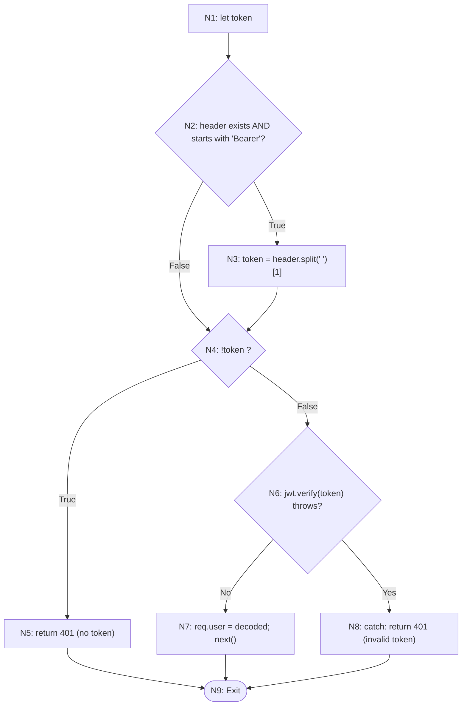
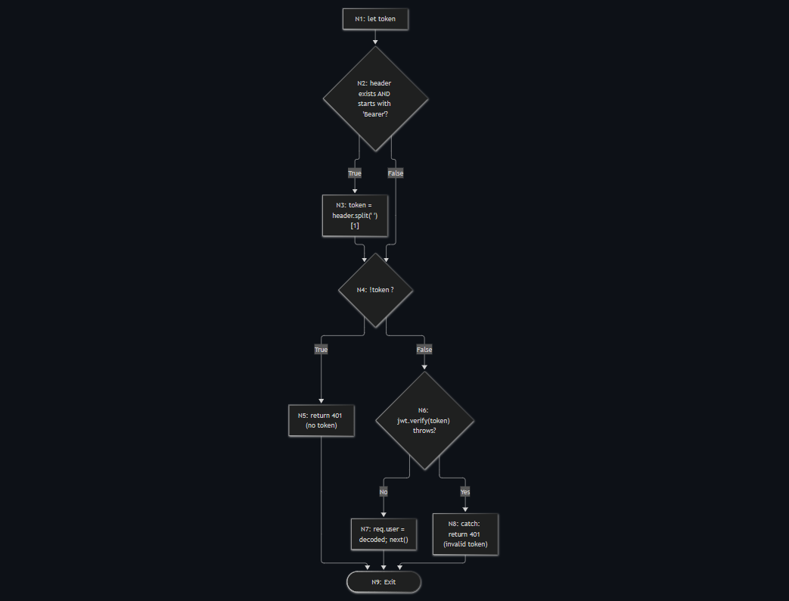
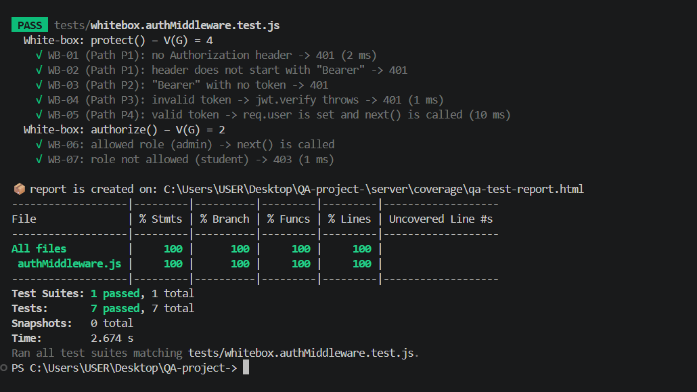
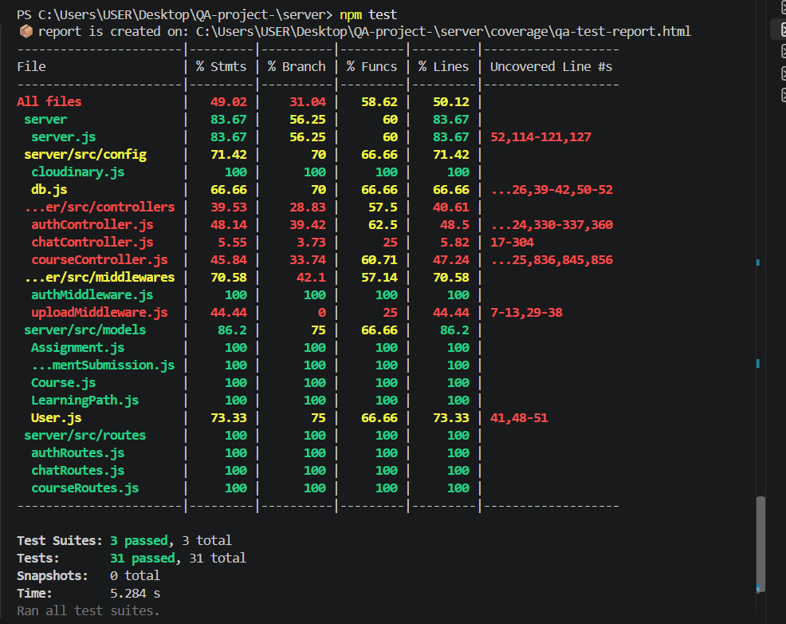

# Member 4 Sections – White-Box Testing (3.4) & TDD / BDD (3.5)

## Section 3.4: White-Box Testing (LO-2)

### 1. Function Under Test
**`protect()`** in `server/src/middlewares/authMiddleware.js` (lines 4–25) is the authentication middleware that guards every protected route. It was chosen because it is security-critical, contains three decision points, and can be unit-tested in isolation without a database.

```js
exports.protect = async (req, res, next) => {
  let token;                                              // N1
  if (req.headers.authorization &&                        // N2 (decision 1)
      req.headers.authorization.startsWith('Bearer')) {
    token = req.headers.authorization.split(' ')[1];      // N3
  }
  if (!token) {                                           // N4 (decision 2)
    return res.status(401).json({ ... });                 // N5
  }
  try {
    const decoded = jwt.verify(token, process.env.JWT_SECRET); // N6 (decision 3: throws?)
    req.user = decoded;                                   // N7
    next();
  } catch (error) {
    return res.status(401).json({ ... });                 // N8
  }
};                                                        // N9 (exit)
```

### 2. Control Flow Graph (CFG)



### 3. Cyclomatic Complexity
- Nodes **N = 9**, Edges **E = 11** (N1→N2, N2→N3, N2→N4, N3→N4, N4→N5, N4→N6, N6→N7, N6→N8, N5→N9, N7→N9, N8→N9), connected components **P = 1**
- **V(G) = E − N + 2P = 11 − 9 + 2 = 4**
- Check with predicate nodes: **V(G) = P + 1 = 3 + 1 = 4** (decisions N2, N4, N6)
- Risk level: **1–10 = Low** – simple and easy to test.
- `authorize()` (lines 28–38) has one decision, so **V(G) = 2**.

**Basis paths (4):**
| Path | Nodes | Meaning |
|---|---|---|
| P1 | N1 → N2 → N4 → N5 → N9 | No header / not a Bearer header |
| P2 | N1 → N2 → N3 → N4 → N5 → N9 | "Bearer" with an empty token |
| P3 | N1 → N2 → N3 → N4 → N6 → N8 → N9 | Token present but invalid |
| P4 | N1 → N2 → N3 → N4 → N6 → N7 → N9 | Valid token, access granted |

### 4. Test Cases for 100% Statement and Branch Coverage
Tool: Jest with mocked `req`, `res` and `next` (`server/tests/whitebox.authMiddleware.test.js`).

| TC ID | Input (Authorization header / role) | Path | N2 | N4 | N6 | Expected | Actual | Status |
|---|---|---|---|---|---|---|---|---|
| WB-01 | *(none)* | P1 | F (A=F) | T | – | 401, next() not called | 401 | Pass |
| WB-02 | `Basic abc123` | P1 | F (A=T, B=F) | T | – | 401 | 401 | Pass |
| WB-03 | `Bearer` | P2 | T | T | – | 401 | 401 | Pass |
| WB-04 | `Bearer invalid.token.value` | P3 | T | F | Throws | 401 | 401 | Pass |
| WB-05 | `Bearer <valid JWT>` | P4 | T | F | No throw | next() called, req.user set | next() called, role = student | Pass |
| WB-06 | authorize('instructor','admin'), role = admin | – | – | – | – | next() called | next() called | Pass |
| WB-07 | authorize('instructor','admin'), role = student | – | – | – | – | 403 | 403 | Pass |

- **Statement coverage:** every statement N1–N9 is executed by WB-01…WB-05.
- **Branch coverage:** N2, N4 and N6 each take both their True and False outcomes.
- **Condition coverage (bonus):** WB-01 and WB-02 make each part of the compound condition `A && B` false on its own.
- The 4 basis paths match **V(G) = 4**, which is the minimum number of tests needed for path coverage of `protect()`.

### 5. Coverage Result
| File | % Stmts | % Branch | % Funcs | % Lines |
|---|---|---|---|---|
| authMiddleware.js | 100 | 100 | 100 | 100 |



